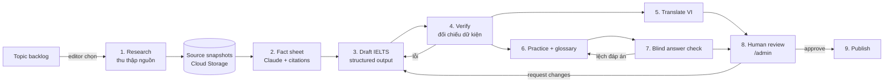

# 05 — Nguồn bài viết, văn phong IELTS và pipeline nội dung

> Phạm vi: lấy nội dung từ đâu, viết theo văn phong nào, quy trình sản xuất bài (AI hỗ trợ + biên tập viên duyệt), bài luyện tập IELTS, chi phí và lộ trình. Data model chi tiết ở [06-database.md](./06-database.md), đăng nhập ở [07-auth.md](./07-auth.md).

## 1. Quyết định chính

| Vấn đề | Quyết định |
|--------|-----------|
| Mô hình kinh doanh | **Miễn phí hoàn toàn**, không paywall, không giới hạn bài/ngày. |
| Ai viết bài | **Claude viết bản nháp từ các nguồn đã thu thập**, sau đó **biên tập viên duyệt và sửa** trước khi xuất bản. Không bài nào lên app mà chưa có người duyệt. |
| Văn phong | **IELTS Academic Reading** là văn phong chung cho mọi bài (mục 2). |
| Nguồn | Ưu tiên nguồn mở có giấy phép rõ ràng (Wikipedia, OpenAlex, Europe PMC, dữ liệu chính phủ, Our World in Data). Báo chí và sách còn bản quyền chỉ dùng để lấy **dữ kiện**, kèm link, không chép câu chữ (mục 4). |
| Viết lại, không chép | Mọi câu trong bài đều là câu viết mới. Có kiểm tra tự động độ trùng với nguồn (mục 6). |
| Song ngữ | Bản gốc tiếng Anh (vì người học IELTS cần đọc tiếng Anh). Bản tiếng Việt do Claude dịch, biên tập viên kiểm tra. |
| Luyện tập | Mỗi bài có một bộ câu hỏi kiểu IELTS (10–14 câu) và danh sách từ vựng học thuật. |
| Model | `claude-opus-5-5` cho mọi bước (mục 5.2). |

## 2. Văn phong IELTS Academic Reading (house style)

### 2.1 Đặc điểm cần bắt chước

Bài đọc IELTS Academic lấy từ sách, tạp chí, báo khoa học phổ thông, viết cho người đọc không chuyên. Một đề thi có 3 bài, tổng 2.150–2.750 từ, 40 câu, 60 phút; mỗi bài khoảng 700–1.000 từ. Những đặc điểm Reader sẽ giữ:

- **Văn phong học thuật, ngôi thứ ba**, trung tính. Không xưng "bạn" trong thân bài.
- **Đoạn văn có nhãn chữ cái** A, B, C… (dùng cho dạng câu hỏi *Matching information*, *Matching headings*).
- **Dẫn nguồn theo người và tổ chức**: "Professor Daniel Kahneman of Princeton University argued that…", "A 2010 study at University College London found…".
- **Rào đón (hedging)**: *suggests, appears to, it is widely thought that, there is some evidence that*.
- **Nhiều quan điểm**: có ý kiến trái chiều, có phần "tuy nhiên", có giới hạn của nghiên cứu.
- **Diễn tiến lịch sử hoặc lập luận** rõ ràng: bối cảnh → phát hiện → tranh luận → ứng dụng.
- **Số liệu, năm, tên riêng** đủ dày để ra câu hỏi điền từ.
- **Từ vựng học thuật**: dùng tự nhiên các từ trong Academic Word List (AWL), như *phenomenon, significant, interpret, constrain*.

### 2.2 Cấu trúc bài trong Reader

| Thành phần | Quy tắc | Hiển thị trong app |
|-----------|---------|--------------------|
| `title` | ≤ 12 từ, có thể là câu hỏi | Tiêu đề Cover |
| `standfirst` | 40–70 từ, gợi tò mò; được phép đặt câu hỏi, vẫn ở ngôi thứ ba | Đoạn hook chữ lớn ở đầu Details |
| `paragraphs` A–G | 6–8 đoạn, mỗi đoạn 90–130 từ, tổng thân bài 700–950 từ | Mỗi đoạn là một section; nhãn chữ cái nhỏ màu `--fg3` trước đoạn |
| `heading` của đoạn | Tùy chọn, ≤ 10 từ | H2 ở chế độ đọc thường; **ẩn** ở chế độ luyện thi |
| `keyPoint` | 40–60 từ, ẩn dụ đời thường + một câu hỏi hành động. Được xưng "you" (đây là phần của app, không phải bài thi) | Thẻ KEY POINT |
| `applySteps` | Đúng 3 bước, bắt đầu bằng động từ | Màn Comments & Apply |
| `glossary` | 8–12 từ học thuật có trong bài | Gạch chân chấm trong bài; chạm để xem nghĩa |
| `practice` | 10–14 câu, 3–4 dạng | Tab "Practice" (mục 3) |
| `sources` | 3–10 nguồn | `[Source · N]` và sheet Sources |

Trình độ mục tiêu: **B2–C1** (band 6.0–7.5). Mỗi bài gắn `level` (`B2`, `C1`, `C2`), tính từ độ dài câu trung bình, tỷ lệ từ AWL và từ ngoài 5.000 từ thông dụng, rồi biên tập viên xác nhận.

### 2.3 Ví dụ (đoạn mở của bài mẫu, viết lại theo văn phong IELTS)

> **Why do capable people freeze at important crossroads?**
>
> *Faced with a new job offer or a move abroad, many otherwise decisive people find themselves unable to act. Psychologists increasingly argue that the cause lies less in a lack of information than in the way the human brain processes choice.*
>
> **A** It has been estimated that an adult makes thousands of decisions every day, from trivial choices about food to consequential ones about work and relationships. Researchers studying what has become known as *decision fatigue* suggest that each of these choices draws on a limited pool of mental resources. By the end of the day, the quality of judgement appears to decline measurably, although the size of the effect remains a subject of debate.
>
> **B** In *Thinking, Fast and Slow* (2011), the Nobel laureate Daniel Kahneman distinguished between two modes of thought. …

So với bản cũ: con số "35.000 quyết định" (ước tính phổ biến, không có nghiên cứu gốc chắc chắn) được viết thành "thousands of decisions", và có thêm câu rào đón "remains a subject of debate". Bài viết theo IELTS phải tuân thủ đúng mức độ chắc chắn mà nguồn cho phép.

### 2.4 Lưu ý thương hiệu

IELTS là nhãn hiệu của British Council, IDP và Cambridge University Press & Assessment. Reader ghi là "IELTS-style practice", không dùng logo, không nói là đề thi chính thức, và có dòng miễn trừ trong màn Practice và trang About.

## 3. Luyện tập kiểu IELTS (tính năng mới)

### 3.1 Dạng câu hỏi (giai đoạn 1)

| Dạng | Số câu/bài | Ghi chú tạo đề |
|------|-----------|----------------|
| True / False / Not Given | 4–5 | Mỗi đáp án NOT GIVEN phải được kiểm chứng là bài không nhắc tới (bước blind-answer, mục 6) |
| Matching headings | 1 câu cho mỗi đoạn được chọn (4–6 đoạn) | Danh sách heading phải viết khác heading đang hiển thị, kèm 2–3 heading gây nhiễu |
| Sentence completion | 3–4 | "NO MORE THAN TWO WORDS AND/OR A NUMBER"; đáp án là cụm có nguyên văn trong bài |
| Multiple choice | 2–3 | 4 lựa chọn, 1 đúng |

Giai đoạn 2: *Matching information*, *Summary completion*, *Yes / No / Not Given* (quan điểm tác giả), và **Mock test**: 3 bài, 40 câu, 60 phút, quy đổi band ước tính.

### 3.2 Trải nghiệm

- Màn thứ ba (vuốt trái từ Details) đổi thành **"Practice & Apply"**, có segmented control 3 tab: **Practice · Apply · Comments**.
- Bắt đầu Practice: bài đọc chuyển sang **exam view**, gồm nhãn đoạn A–G, ẩn heading và highlight, chữ đen-trắng dễ đọc. Đồng hồ đếm giờ tùy chọn (mặc định 20 phút).
- Nộp bài: chấm ngay trên client (đáp án nằm trong `quizzes/{articleId}`, xem 06). Mỗi câu có giải thích và **câu bằng chứng** (đoạn + vị trí ký tự); chạm vào thì cuộn tới và tô sáng câu đó trong bài.
- Lưu lượt làm vào `users/{uid}/quizAttempts`; trang Profile có thống kê theo dạng câu hỏi (ví dụ: TFNG đúng 62%) để người học biết điểm yếu.
- So khớp sentence completion: bỏ phân biệt hoa thường, bỏ dấu câu, chấp nhận các đáp án thay thế trong `acceptedAnswers`.

### 3.3 Từ vựng

- Từ trong `glossary` được gạch chân chấm. Chạm vào mở popover gồm từ loại, phiên âm IPA, nghĩa tiếng Anh, nghĩa tiếng Việt, ví dụ trong bài và nhãn AWL/CEFR.
- Nút "Lưu từ" thêm vào `users/{uid}/words`. Giai đoạn 2: ôn tập flashcard theo lặp lại ngắt quãng (spaced repetition).

### 3.4 Functional requirements bổ sung

| ID | Yêu cầu |
|----|---------|
| FR-28 | Hiển thị nhãn đoạn A–G trước mỗi section; exam view ẩn heading và highlight. |
| FR-29 | Bộ câu hỏi theo 4 dạng ở 3.1, chấm điểm, giải thích, cuộn tới câu bằng chứng. |
| FR-30 | Lưu lịch sử làm bài và thống kê theo dạng câu hỏi. |
| FR-31 | Popover từ vựng và lưu từ. |
| FR-32 | Bộ lọc Explore theo trình độ (B2/C1/C2) và chủ đề IELTS (mục 4.3). |

## 4. Nguồn nội dung

### 4.1 Nguyên tắc pháp lý và đạo đức

1. **Viết mới, không chép.** Dữ kiện và ý tưởng không thuộc bản quyền, còn câu chữ thì có. Claude chỉ nhận **danh sách dữ kiện kèm trích dẫn** (mục 5, bước 3) để viết, không nhận nguyên văn bài nguồn ở bước viết.
2. **Ghi nguồn mọi dữ kiện**: tên, nhà xuất bản, năm, URL/DOI trong `sources`.
3. **Tôn trọng giấy phép và điều khoản**: gọi API chính thức, gửi `User-Agent` có email liên hệ, tuân thủ rate limit và robots.txt, không cào nội dung sau paywall.
4. **Chỉ dùng tóm tắt (abstract) cho bài báo khoa học trả phí.** Toàn văn chỉ dùng khi giấy phép cho phép (Open Access, CC BY).
5. **Trích dẫn nguyên văn** chỉ tối đa 1 câu ngắn, có ngoặc kép và ghi tên tác giả, và chỉ khi câu đó thật sự cần.
6. **Chủ đề sức khoẻ**: kèm dòng "Thông tin tham khảo, không thay thế tư vấn y tế"; chỉ dùng nguồn y khoa có bình duyệt hoặc cơ quan y tế.

### 4.2 Danh sách nguồn

| Nhóm | Nguồn | Giấy phép | Dùng để | Cách lấy |
|------|-------|-----------|---------|----------|
| **A. Nguồn mở, dữ kiện tổng quan** | Wikipedia (EN, VI) | CC BY-SA 4.0 | Bối cảnh, dữ kiện, tìm chủ đề hot | Wikimedia REST API (summary, page HTML, `feed/featured` "most read") |
| | Our World in Data | CC BY 4.0 | Số liệu, biểu đồ | Tải CSV/grapher API |
| | Cơ quan chính phủ Mỹ: NASA, NIH, CDC, NOAA | Phần lớn là public domain | Khoa học, sức khoẻ, môi trường, vũ trụ | Trang chính thức, API của NASA |
| | Project Gutenberg | Public domain | Sách kinh điển, lịch sử tư tưởng | Gutendex API |
| **B. Nghiên cứu khoa học** | OpenAlex | CC0 (metadata, abstract) | Tìm bài nghiên cứu theo chủ đề, số trích dẫn, abstract | OpenAlex REST API (kiểm tra yêu cầu API key và rate limit hiện hành) |
| | Europe PMC / PubMed Central OA | Theo từng bài (nhiều bài CC BY) | Abstract, toàn văn Open Access y sinh và tâm lý | Europe PMC REST API |
| | PubMed (NCBI E-utilities) | Abstract để tham khảo | Abstract y sinh | E-utilities API |
| | arXiv | Theo từng bài | Vật lý, CS, AI (ghi rõ là *preprint*) | arXiv API |
| | Crossref | Metadata mở | Kiểm tra DOI, năm, tạp chí | Crossref REST API |
| **C. Chỉ lấy dữ kiện + link** | Báo chí: Reuters, BBC, The Guardian, CNBC… | Bản quyền | Tin mới, số liệu thời sự | Claude `web_search` với `allowed_domains`, người duyệt kiểm tra lại |
| | The Conversation | CC BY-ND 4.0 (không được sửa) | Bài của nhà nghiên cứu, gợi ý chủ đề | Chỉ lấy dữ kiện vì Reader luôn viết lại |
| | WHO | Thường là CC BY-NC-SA 3.0 IGO | Số liệu y tế toàn cầu | Chỉ lấy dữ kiện + link |
| | Sách còn bản quyền | Bản quyền | Ý tưởng chính của tác giả (Kahneman, Clear…) | Không tóm tắt từng chương; chỉ nêu ý chính kèm tên sách và năm |
| **D. Ảnh/video nền** | Unsplash API | Unsplash License (ghi công tác giả, hotlink, gọi endpoint download) | Ảnh cover | Cần đăng ký app production |
| | Pexels API | Pexels License (khuyến khích ghi công) | Ảnh và **video** cover | API key |
| | Wikimedia Commons | Theo từng file | Ảnh lịch sử, khoa học | Lưu `license`, `author` cho từng file |
| | NASA Image Library | Phần lớn public domain | Vũ trụ | API |

### 4.3 Tìm chủ đề (topic discovery)

- **Danh sách chủ đề IELTS kinh điển** làm xương sống: Education, Environment & Climate, Technology & AI, Health & Medicine, Psychology & Behaviour, Urban Planning, Archaeology & History, Animals & Biology, Space, Language & Linguistics, Business & Economics, Food & Agriculture, Energy, Art & Culture.
- **Tự động gợi ý** (Cloud Function chạy hằng ngày):
  - Wikipedia "most read" và các bài đang được chỉnh sửa nhiều, để tìm chủ đề đang được quan tâm.
  - OpenAlex: các nghiên cứu được trích dẫn nhiều trong 12 tháng gần nhất thuộc các concept trên.
  - Lọc trùng với kho bài: so khớp từ khoá đã chuẩn hoá giữa tiêu đề và keywords (hệ số Jaccard > 0,5 thì đánh dấu "có thể trùng").
- **Biên tập viên** chọn chủ đề từ backlog, đặt mức ưu tiên và trình độ mục tiêu.

## 5. Pipeline sản xuất bài

### 5.1 Sơ đồ

Điều phối: mỗi bước là một Cloud Function (Node 20, TypeScript) nhận job từ **Cloud Tasks**. Trạng thái lưu ở `pipelineRuns/{runId}` (xem 06). Mỗi bước idempotent: chạy lại cùng một input thì ghi đè cùng output. Retry tối đa 3 lần, backoff theo cấp số nhân. **Cloud Scheduler** khởi động lô hằng đêm.

### 5.2 Model và tính năng Claude API

- **Model:** `claude-opus-5-5` (1M context, $4 / $20 cho mỗi triệu token input/output) cho mọi bước. Nếu sau này muốn giảm chi phí cho các bước khối lượng lớn (dịch, blind-answer), có thể đổi sang `claude-sonnet-5-5` hoặc `claude-haiku-5-5`. Đó là quyết định của bạn và nên đo chất lượng trước khi đổi.
- **Effort** đặt trong `output_config.effort`. Default của Opus 5.5 là `medium`, nên ghi rõ cho từng bước: research `medium`, fact sheet `high`, draft `high`, verify `high`, translate `medium`, practice `high`, blind-answer `low`. Thinking luôn bật (adaptive); không gửi `budget_tokens`.
- **SDK:** `@anthropic-ai/sdk` (TypeScript). Request dài thì dùng streaming và `finalMessage()`.
- **Message Batches API** (rẻ hơn 50%, chạy bất đồng bộ) cho các bước 2–7 của lô hằng đêm. Kết quả trả về không theo thứ tự nên luôn ghép theo `custom_id = "{runId}:{step}"`.
- **Structured outputs** (`output_config.format` với JSON schema) cho các bước 3, 4, 5, 6, 7, để output khớp đúng schema ở 06 rồi validate thêm bằng Zod.
- **Citations** (`citations: {enabled: true}` trên các khối `document` chứa nguồn) cho bước 2. Mỗi dữ kiện nhận về đều có `cited_text` và vị trí trong nguồn. Lưu ý: citations **không dùng chung được** với `output_config.format`, nên bước 2 đọc trích dẫn từ các khối text trả về rồi tự chuyển thành JSON.
- **Web search / web fetch** (`web_search_20260209`, `web_fetch_20260209`) ở bước 1 để tìm thêm nguồn báo chí, giới hạn bằng `allowed_domains` theo danh sách nhóm C. Kết quả lỗi của server tool vẫn trả về HTTP 200 kèm `error_code`, nên phải kiểm tra.
- **Prompt caching**: phần system prompt (house style ở mục 2 + rubric + schema) cố định và đặt đầu tiên, dùng `cache_control`. Fact sheet của một bài được cache để dùng lại ở bước 3, 4, 6. Không đưa timestamp hay ID thay đổi theo request vào phần prefix.
- **Refusal**: luôn kiểm tra `stop_reason` trước khi đọc nội dung. Bật fallback phía server (`fallbacks: "default"` với beta `server-side-fallback-2026-07-01`). Nếu vẫn `refusal` thì đánh dấu run `needs_human`.
- **Không dùng** forced `tool_choice` (`any`/`tool` báo lỗi 400 trên Opus 5.5); thay bằng structured outputs.
- `ANTHROPIC_API_KEY` lưu trong **Secret Manager**, chỉ Cloud Functions đọc được. Client không bao giờ gọi Claude trực tiếp.

### 5.3 Chi tiết từng bước

| # | Bước | Input | Output | Ghi chú |
|---|------|-------|--------|---------|
| 1 | Research | Topic, level, category | 5–15 `sources` + snapshot văn bản (Cloud Storage `sources/{sourceId}.txt`) | Gọi API của nguồn A/B trước, `web_search` sau. Lưu `license` cho từng nguồn. Loại nguồn không rõ giấy phép |
| 2 | Fact sheet | Snapshot nguồn dạng `document` + citations | 25–60 `facts`: `{id, statement, sourceId, citedText, location, confidence, isNumber}` | Prompt yêu cầu nêu cả quan điểm trái chiều và giới hạn của nghiên cứu |
| 3 | Draft | Fact sheet (không có nguyên văn nguồn) + house style | `ArticleDraft` JSON: title, standfirst, paragraphs A–G (body dạng rich markup), mỗi câu có dữ kiện gắn `factIds`, keyPoint, applySteps, keywords, level | Không được nêu số, tên hay năm nào không có trong fact sheet |
| 4 | Verify | Draft + fact sheet + `citedText` | Danh sách `issues`: câu không có dữ kiện hỗ trợ, khẳng định quá mức nguồn, sai số/năm | Có lỗi nghiêm trọng thì quay lại bước 3 (tối đa 2 vòng), sau đó chuyển cho người |
| 5 | Translate VI | Draft đã qua verify + glossary thuật ngữ | Bản VI giữ nguyên markup, số, tên riêng | Thuật ngữ lần đầu xuất hiện giữ tiếng Anh trong ngoặc nghiêng |
| 6 | Practice + glossary | Bản EN | `Quiz` JSON (mục 3.1) với `evidence` cho từng câu; `glossary` 8–12 từ | Đáp án sentence completion phải là chuỗi có trong bài |
| 7 | Blind answer | Chỉ bài EN + câu hỏi (không có đáp án) | Đáp án của model | So với đáp án gốc; lệch câu nào thì tạo lại câu đó (tối đa 2 vòng), vẫn lệch thì chuyển cho người |
| 8 | Human review | Mọi output + báo cáo kiểm tra | `approved` / `changes_requested` / `rejected` | Checklist ở mục 6.2 |
| 9 | Publish | Bản đã duyệt | `articles/{id}` + `quizzes/{id}` + index tìm kiếm | Chọn ảnh/video cover, đặt lịch xuất bản |

## 6. Kiểm soát chất lượng

### 6.1 Kiểm tra tự động (chạy sau bước 4–7, kết quả hiển thị trong /admin)

| Kiểm tra | Ngưỡng đạt |
|----------|-----------|
| Mọi số, năm, tên người/tổ chức trong bài đều gắn `factIds` | 100% |
| Verify không còn lỗi mức `high` | 0 lỗi |
| **Độ trùng với nguồn** (n-gram 8 từ, chuẩn hoá chữ thường) | Không có chuỗi 8 từ nào trùng với snapshot nguồn, trừ tên riêng và trích dẫn có ngoặc kép |
| Độ dài | Standfirst 40–70 từ; 6–8 đoạn; thân bài 700–950 từ |
| Trình độ | `level` tính được khớp `level` mục tiêu ± 1 bậc |
| Blind answer | Khớp 100% đáp án |
| Bản dịch | Số lượng số, năm, tên riêng khớp bản EN; markup cân bằng |
| Câu hỏi NOT GIVEN | Bước verify xác nhận bài không nhắc tới |

### 6.2 Checklist người duyệt

- Dữ kiện đúng và nguồn mở ra được (bấm thử ít nhất các nguồn của số liệu).
- Không có khẳng định y khoa hay tài chính nào dễ gây hiểu lầm.
- Văn phong IELTS: ngôi thứ ba, có rào đón, có quan điểm trái chiều.
- Câu hỏi không mơ hồ; đáp án TFNG chỉ có một cách hiểu.
- Bản tiếng Việt tự nhiên và thuật ngữ đúng.
- Ảnh cover đúng giấy phép và có ghi công.
- Đặt `reviewedAt`. Bài sức khoẻ và công nghệ tự nhắc duyệt lại sau 12 tháng.

### 6.3 Sau khi xuất bản

- Người dùng có thể **báo lỗi nội dung** (menu "…" trên bài → "Report an error"), vào hàng đợi `reports`.
- Bài có tỷ lệ đọc hết thấp hoặc nhiều báo lỗi được đưa vào hàng sửa.

## 7. Công cụ biên tập (/admin)

Route `/admin` trong cùng app Next.js, chỉ người có custom claim `editor` hoặc `admin` (xem 07):

- **Backlog chủ đề**: thêm/sửa, ưu tiên, nguồn gợi ý.
- **Hàng đợi duyệt**: xem bản nháp cạnh fact sheet và nguồn; tô màu câu theo `factIds`; xem diff giữa các vòng.
- **Trình sửa** dạng form theo đúng schema, có preview giống app (dùng lại component của prototype).
- **Báo cáo pipeline**: token và chi phí từng run, lỗi, số vòng lặp.
- **Kiểm duyệt bình luận**: hàng đợi `reports`, ẩn/xoá bình luận.

## 8. Chi phí ước tính (Claude API)

Giả định cho một bài, giá `claude-opus-5-5` là $4 / $20 cho mỗi triệu token; bước 2–7 chạy qua Batch API (giảm 50%). Token output đã gồm phần thinking.

| Bước | Input | Output | Chi phí |
|------|------:|-------:|-------:|
| 1 Research (thường, có web search) | 40K | 4K | ~$0.24 + phí web search |
| 2 Fact sheet (batch) | 30K | 4K | ~$0.10 |
| 3 Draft (batch) | 12K | 8K | ~$0.10 |
| 4 Verify (batch) | 15K | 4K | ~$0.07 |
| 5 Translate (batch) | 6K | 6K | ~$0.07 |
| 6 Practice + glossary (batch) | 8K | 6K | ~$0.08 |
| 7 Blind answer (batch) | 4K | 2K | ~$0.03 |
| **Tổng**, cộng ~30% cho các vòng sửa | | | **≈ $0.9 / bài** |

Ở mức 150 bài/tháng, chi phí khoảng **$135/tháng** cho Claude, chưa gồm Firebase. Đây là ước tính; số thật lấy từ `usage` lưu trong `pipelineRuns` sau 20 bài đầu. Prompt caching sẽ giảm thêm phần input.

## 9. Lộ trình (nối tiếp M0–M8 ở 02)

| M | Phạm vi | Definition of Done |
|---|---------|-------------------|
| **M9** Content model + seed thủ công | Schema mới (06), 20 bài viết tay theo văn phong IELTS cho 8 chủ đề, nhãn đoạn A–G | 20 bài hiển thị đúng trên app, có `sources` đầy đủ |
| **M10** Pipeline v1 | Bước 1–7, `pipelineRuns`, Batch API, kiểm tra tự động 6.1 | Tạo 10 bài thử, ≥ 8 bài qua kiểm tra tự động; chi phí thực tế có trong báo cáo |
| **M11** /admin | Backlog, hàng đợi duyệt, trình sửa, publish | Biên tập viên duyệt và xuất bản một bài từ đầu tới cuối không cần dev |
| **M12** IELTS Practice | Tab Practice, exam view, chấm điểm, lịch sử, từ vựng | FR-28–FR-31; E2E làm bài và xem giải thích |
| **M13** Mở rộng | Topic discovery tự động, mock test 3 bài, flashcard | 60 bài khi ra mắt, sau đó 3–5 bài/ngày |

## 10. Rủi ro

| Rủi ro | Giảm thiểu |
|--------|-----------|
| AI bịa dữ kiện | Chỉ viết từ fact sheet có trích dẫn; bước verify; blind answer; người duyệt |
| Vi phạm bản quyền | Không đưa nguyên văn vào bước viết; kiểm tra n-gram; nguồn nhóm C chỉ lấy dữ kiện; lưu giấy phép |
| Số liệu lan truyền nhưng không có gốc (như "35.000 quyết định/ngày") | Prompt yêu cầu tìm nguồn gốc; không có nguồn sơ cấp thì viết ở mức "it has been estimated", hoặc bỏ |
| Nội dung lỗi thời | `reviewedAt` và nhắc duyệt lại sau 12 tháng |
| Chi phí tăng | Batch API, caching, đo chi phí từng run, ngân sách tháng có cảnh báo |
| Nhầm là đề thi IELTS chính thức | Ghi "IELTS-style", có dòng miễn trừ, không dùng logo |
