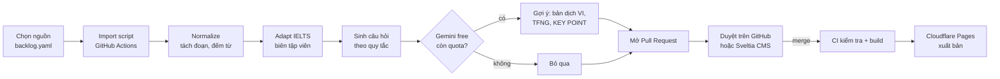

# 05 — Nguồn bài viết, văn phong IELTS và quy trình nội dung (100% miễn phí)

> Ràng buộc: **không dùng Claude API, không dùng dịch vụ trả phí nào.** AI chỉ là phần phụ và chỉ dùng **Gemini API gói miễn phí**. App phải chạy đầy đủ kể cả khi không có AI. Kiến trúc lưu trữ và hosting miễn phí ở [06-database.md](./06-database.md), đăng nhập ở [07-auth.md](./07-auth.md).

## 1. Quyết định chính

| Vấn đề | Quyết định |
|--------|-----------|
| Nguồn bài | **Bài có sẵn mang giấy phép mở** (CC BY, CC BY-SA, public domain), được rút gọn và chia đoạn theo khuôn IELTS. Không tự "viết mới bằng AI" làm nguồn chính. |
| Lý do | Bài đọc IELTS thật vốn lấy từ đúng loại nguồn này (sách giáo khoa, tạp chí khoa học phổ thông, báo nghiên cứu). Nội dung do con người viết, đã có nguồn, không lo AI bịa, chi phí 0 đồng. |
| AI | **Gemini API free tier, tùy chọn**: gợi ý bản dịch tiếng Việt, câu hỏi True/False/Not Given, câu KEY POINT. Mọi output đều qua người duyệt. Hết quota thì quy trình vẫn chạy, chỉ thiếu phần gợi ý. |
| Câu hỏi luyện tập | Phần lớn **sinh bằng quy tắc** (matching headings, điền từ, điền số liệu), không cần AI (mục 5). |
| Duyệt và xuất bản | Bài là file JSON trong **GitHub repo**. Mỗi bài mới là một Pull Request; duyệt xong merge thì site tự build lại. GitHub đóng vai trò CMS miễn phí. |
| Đóng góp cộng đồng | Nút **+** cho người dùng gửi bài tự viết (CC BY 4.0) hoặc gợi ý nguồn; được duyệt như trên. |

## 2. Nguồn bài viết

### 2.1 Nhóm 1: được đăng lại, rút gọn và dịch (CC BY, public domain)

Đây là nguồn chính. Chỉ cần ghi công đúng cách.

| Nguồn | Giấy phép | Nội dung hợp với IELTS | Cách lấy |
|-------|-----------|------------------------|----------|
| **OpenStax** (sách giáo khoa đại học: Psychology, Biology, Sociology, Economics, Astronomy, US History, Anatomy…) | CC BY 4.0 (kiểm tra từng cuốn) | Rất giống văn phong IELTS: học thuật, có số liệu, có nghiên cứu được dẫn tên | Repo GitHub `openstax/osbooks-*` (định dạng CNXML) |
| **Our World in Data**, các bài phân tích | CC BY 4.0 | Môi trường, dân số, y tế, kinh tế, có số liệu dày | Trang bài viết; dữ liệu và biểu đồ qua grapher |
| **Frontiers for Young Minds** | CC BY | Khoa học do nhà khoa học viết cho người trẻ, câu đơn giản (B1–B2) | Website, có XML/PDF từng bài |
| **eLife**: phần *digest* của bài nghiên cứu | CC BY 4.0 (giấy phép của eLife; kiểm tra trên từng bài) | Tóm tắt khoa học cho người không chuyên | Repo `elifesciences/elife-article-xml` (JATS XML) |
| **PLOS**: phần *Author summary* | CC BY 4.0 | Tóm tắt nghiên cứu y sinh dễ hiểu | API/corpus `allofplos` |
| **Cơ quan chính phủ Mỹ**: NIH *News in Health*, NASA Science, NOAA, USGS, National Park Service | Public domain (tác phẩm của chính phủ liên bang Mỹ); ảnh của bên thứ ba thì không | Sức khoẻ, vũ trụ, khí hậu, địa chất, lịch sử | HTML trên trang chính thức |
| **VOA Learning English** (kho bài cũ) | Theo hướng dẫn của thư viện Georgetown: văn bản là public domain, phải ghi công `learningenglish.voanews.com`; ảnh AP/Reuters có bản quyền riêng | Bài tiếng Anh đã phân cấp độ cho người học | Website; tình trạng hoạt động năm 2026 không chắc chắn, nên kiểm tra trước khi dựa vào |
| **Global Voices** | CC BY 3.0 | Văn hoá, xã hội, nhiều quốc gia | Website, RSS |
| **Project Gutenberg / Standard Ebooks** | Public domain (tại Mỹ) | Tiểu luận và sách khoa học kinh điển (Darwin, Faraday…) | Gutendex API, repo của Standard Ebooks |

### 2.2 Nhóm 2: được rút gọn và dịch, nhưng **bài phái sinh phải giữ CC BY-SA**

| Nguồn | Ghi chú |
|-------|---------|
| **Wikipedia** (EN), **Simple English Wikipedia** (dễ hơn, B1–B2) | Dùng các bài *Featured* và *Good articles* vì chất lượng cao. Bài Reader làm từ Wikipedia mang giấy phép **CC BY-SA 4.0** và hiển thị rõ |
| **Wikipedia tiếng Việt** | Có thể dùng bài tiếng Việt cùng chủ đề làm "bản đọc thêm" (không phải bản dịch 1:1) |
| **Wikibooks, Wikiversity** | Bài học có cấu trúc |

### 2.3 Nhóm 3: chỉ đăng lại **nguyên văn**, không dịch, không cắt

| Nguồn | Điều khoản chính |
|-------|------------------|
| **The Conversation** | CC BY-ND 4.0. Bản dịch và việc cắt bớt bị tính là bài phái sinh, **cần tác giả đồng ý**. Phải ghi tác giả, trường, link về bài gốc. Bản UK còn cấm đăng lại có hệ thống toàn bộ bài. Đọc trang *Republishing guidelines* của từng edition trước khi dùng |
| **ProPublica** | CC BY-NC-ND: không sửa, không thương mại |

Cách dùng nhóm 3 trong Reader: chỉ hiển thị bản **tiếng Anh nguyên văn**, không highlight hay thêm KEY POINT vào thân bài. Câu hỏi luyện tập và từ vựng được đặt ở tab riêng. Nếu muốn có bản tiếng Việt, liên hệ tác giả xin phép (The Conversation có nút *Contact* trên trang tác giả) và lưu bằng chứng đồng ý trong repo.

### 2.4 Nhóm 4: nội dung tự viết

- **Biên tập viên và cộng đồng** viết bài mới theo khuôn IELTS (mục 3) qua nút **+** trong app (gửi vào hàng đợi) hoặc PR trên GitHub. Bài tự viết mang giấy phép **CC BY 4.0** của Reader; người viết đồng ý điều khoản khi gửi.
- Người viết phải ghi nguồn cho mọi số liệu, theo quy tắc ở PRD §5.

### 2.5 Không dùng

- Báo chí và sách còn bản quyền (CNBC, BBC, sách của Kahneman…): **không đăng lại**, chỉ được dẫn link khi bài tự viết cần nguồn.
- Đề IELTS thật (Cambridge IELTS…): có bản quyền.
- Nội dung không ghi rõ giấy phép.

### 2.6 Ảnh và video nền (miễn phí)

| Nguồn | Điều kiện |
|-------|-----------|
| **Unsplash API** | Miễn phí; phải hotlink ảnh từ Unsplash, ghi tên tác giả, gọi endpoint download khi dùng |
| **Pexels API** | Miễn phí, có cả **video**; khuyến khích ghi công |
| **Wikimedia Commons** | Theo giấy phép từng file; lưu `author`, `license` |
| **NASA Image and Video Library** | Phần lớn public domain |
| Ảnh đi kèm bài nguồn | Chỉ dùng khi ảnh cùng giấy phép với bài (ảnh trong OpenStax, eLife thường là CC BY; ảnh AP/Reuters trong bài VOA thì **không**) |

Không lưu ảnh trên Firebase Storage (cần gói trả phí). Ảnh được hotlink từ nguồn hoặc lưu nhỏ gọn trong repo.

## 3. Khuôn bài IELTS áp dụng cho bài nguồn

Bài nguồn thường dài hơn hoặc không đúng hình dạng IELTS. Bước **adapt** (làm bằng tay hoặc với trợ giúp của script) đưa bài về khuôn:

| Thành phần | Quy tắc |
|-----------|---------|
| `title` | Giữ tiêu đề gốc hoặc đặt lại (≤ 12 từ). Với nhóm 3 thì giữ nguyên |
| `standfirst` | 40–70 từ: lấy đoạn mở của bài gốc, hoặc biên tập viên viết một câu dẫn |
| `paragraphs` A–G | 6–8 đoạn liên tiếp, **700–950 từ**. Với nhóm 1–2: chọn một đoạn liền mạch của bài/chương, cho phép cắt câu thừa và gộp đoạn ngắn. Mỗi thay đổi được liệt kê trong `changes` để ghi công |
| `heading` | Lấy từ tiêu đề mục của bài gốc (OpenStax, Wikipedia đều có), dùng luôn cho câu hỏi matching headings |
| Highlight | Biên tập viên đánh dấu tối đa 3 cụm mỗi đoạn (không áp dụng cho nhóm 3) |
| `keyPoint` | Biên tập viên viết (Gemini có thể gợi ý); không áp dụng cho nhóm 3 |
| `applySteps` | 3 bước, biên tập viên viết; tùy chọn cho bài khoa học thuần |
| `level` | Tính tự động (mục 5.4) |
| `attribution` | Sinh tự động, hiển thị cuối bài: *"Adapted from 'Decision Making' by Rose M. Spielman et al., OpenStax Psychology 2e, CC BY 4.0. Changes: shortened, divided into lettered paragraphs, questions added."* |

Chế độ đọc thường giữ nguyên giao diện của prototype (H2, highlight, KEY POINT). Chế độ **exam view** khi luyện tập ẩn heading và highlight, chỉ hiện nhãn đoạn A–G (FR-28).

IELTS là nhãn hiệu của British Council, IDP và Cambridge University Press & Assessment. Reader ghi "IELTS-style practice", không dùng logo, có dòng miễn trừ.

## 4. Quy trình nội dung

### 4.1 Sơ đồ

### 4.2 Các bước

| # | Bước | Ai/cái gì làm | Output |
|---|------|---------------|--------|
| 1 | **Backlog** | Biên tập viên thêm dòng vào `content/backlog.yaml` (nguồn, URL, chủ đề IELTS, trình độ mục tiêu) hoặc người dùng gợi ý qua app | Danh sách việc |
| 2 | **Import** | Script `scripts/import/<source>.ts` chạy trong GitHub Actions (thủ công hoặc theo lịch). Mỗi nguồn có một adapter: OpenStax (CNXML), eLife (JATS XML), Wikipedia (REST `page/html`), Gutenberg (text), HTML (dùng Readability) | `content/raw/<id>.json`: văn bản sạch, các mục, tác giả, giấy phép, URL |
| 3 | **Normalize** | Script | Tách đoạn, đếm từ, gợi ý đoạn 700–950 từ phù hợp nhất (liền mạch, có heading) |
| 4 | **Adapt** | Biên tập viên chỉnh trong CMS: chọn đoạn, cắt, đặt standfirst, highlight, KEY POINT | `content/articles/<slug>.json` (bản EN) |
| 5 | **Câu hỏi theo quy tắc** | Script (mục 5) | `quiz` trong file bài |
| 6 | **Gợi ý bằng Gemini** (tùy chọn) | Script gọi Gemini free tier, có hàng đợi và theo dõi quota | Các field có cờ `"aiSuggested": true` để người duyệt kiểm tra |
| 7 | **Pull Request** | GitHub Action tự mở PR | PR kèm báo cáo kiểm tra |
| 8 | **Duyệt** | Biên tập viên (người có quyền merge) | Merge, hoặc yêu cầu sửa |
| 9 | **Build và xuất bản** | Cloudflare Pages build lại site tĩnh | Bài lên app; chỉ mục tìm kiếm được tạo lại |

### 4.3 Kiểm tra tự động trên PR (GitHub Actions, miễn phí)

| Kiểm tra | Ngưỡng |
|----------|--------|
| Schema JSON (Zod) | Đạt |
| `license` thuộc danh sách cho phép và khớp nhóm nguồn | Đạt |
| Nhóm 3 (ND): thân bài **giống hệt** bản gốc đã import | 100% |
| Có `attribution` và link gốc | Đạt |
| Độ dài | Standfirst 40–70 từ; 6–8 đoạn; thân bài 700–950 từ (nhóm 3 được miễn) |
| Câu hỏi | Mỗi đáp án điền từ có trong bài; matching headings có đủ heading gây nhiễu |
| Field `aiSuggested` | Phải được người duyệt chuyển thành `false` (đã kiểm tra) trước khi merge |
| Ảnh cover | Có `author` và `license` |

### 4.4 CMS miễn phí

- **Cách 1, đơn giản nhất:** sửa file JSON ngay trên GitHub web, mỗi bài một PR.
- **Cách 2, cho biên tập viên không rành kỹ thuật:** **Sveltia CMS** (mã nguồn mở, git-based, tương thích cấu hình Decap CMS) đặt ở `/cms`. Biên tập viên đăng nhập bằng GitHub; luồng OAuth chạy trên một Cloudflare Worker miễn phí. CMS hiển thị form theo schema bài, có preview, và khi lưu thì tạo commit/PR.

## 5. Luyện tập IELTS không cần AI

### 5.1 Sinh câu hỏi theo quy tắc

| Dạng | Cách sinh tự động | Chất lượng |
|------|-------------------|-----------|
| **Matching headings** | Lấy heading gốc của các mục (OpenStax, Wikipedia có sẵn), đảo thứ tự, thêm 2–3 heading gây nhiễu từ bài khác cùng chủ đề | Tốt; biên tập viên có thể viết lại heading cho khó hơn |
| **Sentence completion** (NO MORE THAN TWO WORDS AND/OR A NUMBER) | Chọn câu chứa số liệu, năm, tên riêng hoặc thuật ngữ in đậm; khoét 1–2 từ đó; diễn đạt lại phần đầu câu là tùy chọn | Khá; nên diễn đạt lại một chút để không phải tìm từ y hệt |
| **Vocabulary gap-fill** | Khoét các từ thuộc NAWL trong một đoạn, cho danh sách từ để chọn | Tốt cho luyện từ vựng |
| **Matching information** ("Which paragraph contains…") | Lấy câu chứa dữ kiện đặc trưng trong mỗi đoạn, diễn đạt lại ngắn | Cần người diễn đạt lại; script chỉ đề xuất câu |
| **True/False/Not Given, Multiple choice** | Không sinh tự động được tốt: **biên tập viên viết**, Gemini có thể gợi ý (mục 6) | Phụ thuộc người viết |

Mục tiêu mỗi bài: 10–14 câu thuộc ít nhất 3 dạng. Nếu chưa đủ câu TFNG thì bài vẫn xuất bản với các dạng còn lại.

### 5.2 Đóng góp câu hỏi

Người dùng đã đăng nhập có thể **đề xuất câu hỏi** cho một bài (form trong tab Practice). Đề xuất lưu vào Firestore `questionSuggestions`, biên tập viên chọn câu tốt và đưa vào file bài qua PR.

### 5.3 Từ vựng (nguồn mở)

| Dữ liệu | Giấy phép | Dùng cho |
|---------|-----------|----------|
| **NAWL**, New Academic Word List (~960 từ) | CC BY-SA 4.0 | Đánh dấu từ học thuật, câu hỏi gap-fill |
| **NGSL**, New General Service List (~2.800 từ) | CC BY-SA 4.0 | Tính độ khó: từ ngoài NGSL và NAWL được coi là khó |
| **Wiktionary** (dữ liệu trích sẵn của kaikki.org) | CC BY-SA 4.0 | Định nghĩa tiếng Anh, IPA, bản dịch tiếng Việt (khi có) |

Script build tạo `public/data/vocab/<lemma>.json` cho các từ xuất hiện trong bài; app tải khi người dùng chạm vào từ.

### 5.4 Tính trình độ tự động

`level` dựa trên: độ dài câu trung bình, tỷ lệ từ ngoài NGSL, tỷ lệ từ NAWL, chỉ số Flesch–Kincaid. Ngưỡng ban đầu: B2 nếu FK grade ≤ 11 và từ ngoài NGSL ≤ 6%; C1 nếu ≤ 14 và ≤ 10%; còn lại C2. Biên tập viên chỉnh lại và ngưỡng được hiệu chỉnh sau 30 bài đầu.

## 6. Gemini API (gói miễn phí, tùy chọn)

### 6.1 Dùng vào việc gì

| Việc | Được dùng cho nhóm nguồn | Ghi chú |
|------|-------------------------|---------|
| Gợi ý **bản dịch tiếng Việt** | 1, 2, 4 | Không dùng cho nhóm 3 (ND) |
| Gợi ý câu **TFNG, multiple choice** | 1, 2, 3, 4 | Câu hỏi là nội dung riêng của Reader, không sửa bài gốc |
| Gợi ý **KEY POINT**, câu **diễn đạt lại** cho sentence completion | 1, 2, 4 | |
| Gợi ý **3 bước Apply** | 1, 2, 4 | |

Không dùng Gemini để **viết bài** hay **tạo số liệu**. Thân bài luôn đến từ nguồn do con người viết.

### 6.2 Giới hạn và cách vận hành

- Google không công bố một con số cố định cho free tier. Giới hạn (RPM, TPM, RPD) hiển thị theo từng project trong Google AI Studio, và theo các nguồn tổng hợp thì đã nhiều lần bị giảm. Các model Pro hầu như đã chuyển sang gói trả phí. **Thiết kế coi Gemini là thứ có thể biến mất bất cứ lúc nào.**
- Chỉ dùng model **Flash** hoặc **Flash-Lite** đang có trong free tier. Tên model đặt trong biến cấu hình (`GEMINI_MODEL`), không hard-code.
- Chạy **trong GitHub Actions**, không chạy từ app của người dùng. Có hàng đợi (`content/ai-queue.json`), giới hạn số request mỗi lần chạy, và khi gặp lỗi 429 thì dừng và để lần chạy sau làm tiếp.
- **Không bao giờ gửi dữ liệu người dùng** cho Gemini. Prompt ở free tier có thể được Google dùng để cải thiện sản phẩm; nội dung gửi đi chỉ là văn bản có giấy phép mở.
- Key lưu trong **GitHub Actions secrets** (`GEMINI_API_KEY`), không có trong code client.
- Mỗi output được đánh dấu `aiSuggested: true`, và CI không cho merge khi người duyệt chưa xác nhận (4.3).

### 6.3 Khi không có AI

| Phần | Thay thế |
|------|----------|
| Bản tiếng Việt | Tình nguyện viên dịch qua PR; hoặc dùng bài Wikipedia tiếng Việt cùng chủ đề làm "Đọc thêm"; hoặc chỉ có tiếng Anh, kèm popover từ vựng có nghĩa tiếng Việt |
| TFNG | Biên tập viên hoặc cộng đồng viết (5.2) |
| KEY POINT, Apply | Biên tập viên viết; nếu trống thì app ẩn phần này |

Nút đổi ngôn ngữ `en/vi` vẫn đổi toàn bộ giao diện sang tiếng Việt. Bài chưa có bản VI thì hiện tag "Chỉ có tiếng Anh" và giữ nội dung tiếng Anh (FR-21).

## 7. Nhịp sản xuất và lộ trình

Không có chi phí theo bài, nên giới hạn là thời gian của biên tập viên: khoảng 30–45 phút cho mỗi bài (chọn đoạn, highlight, kiểm tra câu hỏi).

| M | Phạm vi | Definition of Done |
|---|---------|-------------------|
| **M9** Content-in-git | Schema bài ở 06, thư mục `content/`, build tĩnh, attribution tự động, 15 bài làm tay từ OpenStax, Wikipedia và NIH News in Health | 15 bài hiển thị đúng; CI kiểm tra giấy phép chạy |
| **M10** Importers | Adapter cho OpenStax, Wikipedia, eLife, Gutenberg, HTML (Readability); normalize; gợi ý đoạn 700–950 từ | Import 1 bài mỗi nguồn trong 1 lệnh |
| **M11** Luyện tập | Sinh câu hỏi theo quy tắc, tab Practice, exam view, chấm điểm, lịch sử | FR-28–FR-30 |
| **M12** Từ vựng | NAWL/NGSL/Wiktionary, popover, lưu từ, tính trình độ | FR-31, FR-32 |
| **M13** CMS + cộng đồng | Sveltia CMS, gợi ý câu hỏi và gửi bài từ app, Gemini (tùy chọn) | Biên tập viên không rành kỹ thuật xuất bản được một bài |
| Ra mắt | 50 bài thuộc 8 chủ đề IELTS, sau đó 3–5 bài/tuần | |

## 8. Rủi ro

| Rủi ro | Giảm thiểu |
|--------|-----------|
| Dùng sai giấy phép | Trường `license` bắt buộc, CI chặn giấy phép ngoài danh sách, nhóm 3 bị kiểm tra không sửa đổi, attribution tự động |
| Nguồn đổi điều khoản (như VOA, The Conversation) | Lưu ngày import và bản điều khoản tại thời điểm import trong `sources/`; xem lại mỗi 6 tháng |
| Bài nguồn lỗi thời (sách giáo khoa vài năm tuổi) | Ưu tiên ấn bản mới; có trường `reviewedAt`; người dùng báo lỗi được |
| Gemini free bị giảm hoặc ngừng | App không phụ thuộc Gemini (6.3) |
| Thiếu biên tập viên | Bắt đầu với nguồn cần ít chỉnh sửa nhất (OpenStax, Simple Wikipedia, Frontiers for Young Minds); cho cộng đồng đóng góp |
