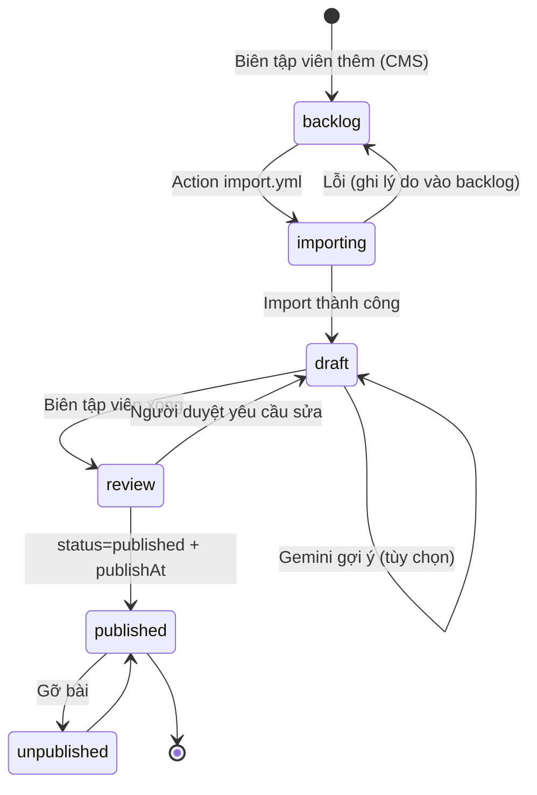
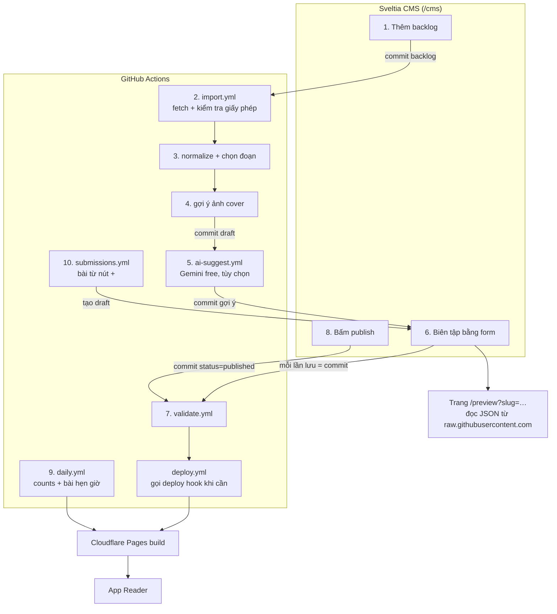

# 05 — Nguồn bài viết và pipeline nội dung

> Ràng buộc: **chỉ clone các tính năng app gốc có**, **chi phí vận hành 0 đồng**, **không dùng Claude API**. AI chỉ là phần phụ và chỉ dùng **Gemini API gói miễn phí**. Repo GitHub **public**; biên tập viên sửa bài qua **form của Sveltia CMS**. Kiến trúc dữ liệu và hosting ở [06-database.md](./06-database.md), đăng nhập ở [07-auth.md](./07-auth.md).

## 1. Phạm vi

### 1.1 Tính năng (chỉ những gì app gốc có)

| Tính năng app gốc | Trong Reader |
|-------------------|--------------|
| Feed lướt dọc, Cover, Details chia section, highlight, chip nguồn, KEY POINT, `[Source · N]`, dots | ✅ |
| Like / Save / Share / Comment kèm số đếm | ✅ |
| Comments & Apply ("Turn what you read into what you do") | ✅ |
| Header: avatar, streak 🔥, chuông thông báo, Explore 🧭, `en/vi` | ✅ |
| Bottom bar: Search, + (đăng bài cá nhân), Messages | ✅ (Messages: giao diện + empty state như app gốc) |
| Đăng nhập Google | ✅ (yêu cầu của bạn) |
| Paywall "Only 128/300 left" | ❌ Bỏ, vì app miễn phí |

**Không làm** (đã đề xuất trước đây, nay bỏ khỏi phạm vi): câu hỏi luyện tập IELTS, exam view, nhãn đoạn A–G, popover từ vựng, lọc theo trình độ, báo lỗi nội dung, đề xuất câu hỏi.

### 1.2 Văn phong nội dung

"Phong cách IELTS Reading" chỉ là **tiêu chí chọn và biên tập bài**, không phải tính năng: văn phong học thuật phổ thông, ngôi thứ ba, có số liệu và tên nhà nghiên cứu, có nhiều quan điểm, dài **700–950 từ**. Bài được hiển thị đúng kiểu app gốc (hook, các section có H2, highlight, KEY POINT, Apply).

## 2. Nguồn bài viết

| Nhóm | Nguồn | Giấy phép | Được làm gì |
|------|-------|-----------|-------------|
| **1. Nguồn chính** | **OpenStax** (Psychology, Biology, Sociology, Economics, Astronomy…) | CC BY 4.0 (kiểm tra từng cuốn) | Rút gọn, chia section, highlight, dịch; ghi công |
| | **Our World in Data** (bài phân tích) | CC BY 4.0 | như trên |
| | **Frontiers for Young Minds** | CC BY | như trên |
| | **eLife** (phần digest), **PLOS** (Author summary) | CC BY 4.0 | như trên |
| | **NIH News in Health, NASA Science, NOAA, USGS, National Park Service** | Public domain (tác phẩm của chính phủ liên bang Mỹ; ảnh bên thứ ba thì không) | như trên |
| | **Project Gutenberg / Standard Ebooks** | Public domain | như trên |
| | **Global Voices** | CC BY 3.0 | như trên |
| | **VOA Learning English** (kho bài cũ) | Văn bản public domain theo hướng dẫn của thư viện Georgetown; ảnh AP/Reuters thì không. Tình trạng năm 2026 chưa chắc chắn | như trên |
| **2. Share-alike** | **Wikipedia**, **Simple English Wikipedia** (bài *Featured/Good*) | CC BY-SA 4.0 | Như nhóm 1, nhưng bài Reader làm ra cũng mang **CC BY-SA 4.0** |
| **3. Chỉ nguyên văn** | **The Conversation** | CC BY-ND 4.0; dịch hoặc cắt bớt cần tác giả đồng ý | Chỉ đăng bản tiếng Anh nguyên văn; không highlight trong thân bài; KEY POINT và Apply là phần riêng của Reader |
| **4. Tự viết** | Biên tập viên; người dùng qua nút **+** | CC BY 4.0 của Reader | Toàn quyền |

**Không dùng:** báo chí và sách còn bản quyền (chỉ được dẫn link làm nguồn trong bài tự viết), đề IELTS thật, nội dung không rõ giấy phép.

**Ảnh cover:** Unsplash API (hotlink, ghi tên tác giả, gọi endpoint download khi dùng), Pexels API (có cả video), Wikimedia Commons, NASA. Không dùng Firebase Storage.

## 3. Khuôn bài (ánh xạ vào giao diện app gốc)

| Field | Quy tắc | Hiện ở |
|-------|---------|--------|
| `title` | ≤ 12 từ | Cover, đầu Details |
| `hook` | 40–80 từ, đoạn mở gợi tò mò | Section đầu (chữ lớn) |
| `sections[]` | 5–7 section, mỗi section ≤ 130 từ, có `heading` tùy chọn; tổng 700–950 từ | Các section có H2 |
| Highlight | ≤ 3 cụm mỗi section: vàng (tên, năm, tổ chức), hồng (số liệu, khái niệm), xanh lá (kết luận) | Chip màu |
| `references[]` + chip | Mỗi số liệu có chip nguồn | Chip xám, sheet Sources |
| `keyPoint` | 40–60 từ, một ẩn dụ đời thường + một câu hỏi hành động | Thẻ KEY POINT |
| `applySteps` | Đúng 3 bước, bắt đầu bằng động từ | Màn Comments & Apply |
| `cover` | Ảnh/video có `author`, `license` | Nền Cover/Details |
| `origin` | Nguồn gốc, giấy phép, danh sách thay đổi | Dòng ghi công cuối bài + sheet Sources |
| `title/hook/sections/keyPoint/applySteps` tiếng Việt | Tùy chọn | Khi chọn `vi`; nếu thiếu thì hiện tag "Chỉ có tiếng Anh" |

## 4. Tổng quan pipeline

### 4.1 Trạng thái của một bài



- `draft` và `review` **không** lên app, chỉ xem được qua trang preview (4.3).
- `published` chỉ hiện trên feed khi `publishAt` ≤ hôm nay **và** bài qua kiểm tra tự động.
- Nếu chỉ có một biên tập viên, có thể chuyển thẳng `draft → published`.

### 4.2 Ai làm gì

| Vai trò | Ai | Công cụ |
|---------|----|---------|
| Biên tập viên | Người có quyền **write** trên repo GitHub | Sveltia CMS tại `/cms` (đăng nhập GitHub) |
| Người duyệt | Biên tập viên khác (hoặc chính người viết) | CMS + trang preview |
| Máy | GitHub Actions (miễn phí, repo public) | `import.yml`, `ai-suggest.yml`, `validate.yml`, `deploy.yml`, `daily.yml`, `submissions.yml` |
| Hosting | Cloudflare Pages | Deploy hook |

### 4.3 Sơ đồ đầy đủ



## 5. Chi tiết từng bước

### Bước 0. Thiết lập một lần

1. Repo public `Reader`; branch `main` là production.
2. **Cloudflare Pages**: kết nối repo, build command `pnpm build`, output `out/`. **Tắt automatic deployments** cho branch `main`; tạo **Deploy hook** và lưu URL vào GitHub secret `CF_PAGES_DEPLOY_HOOK`. Lý do: mỗi lần lưu trong CMS là một commit; nếu commit nào cũng build thì quota 500 build/tháng sẽ hết. Build chỉ được gọi khi cần (bước 8).
3. **Sveltia CMS**: thêm `public/cms/index.html` (tải Sveltia CMS từ CDN) và `public/cms/config.yml` (mục 6.2).
4. **Đăng nhập CMS bằng GitHub**: deploy Worker `sveltia-cms-auth` lên Cloudflare Workers (miễn phí), tạo GitHub OAuth App trỏ callback về Worker, rồi đặt `base_url` trong `config.yml`. Cách dự phòng: Sveltia cho nhập Personal Access Token.
5. **Secrets của GitHub Actions**: `FIREBASE_SERVICE_ACCOUNT_JSON`, `CF_PAGES_DEPLOY_HOOK`, `UNSPLASH_ACCESS_KEY`, `PEXELS_API_KEY`, `GEMINI_API_KEY` (tùy chọn). Không secret nào nằm trong code client.
6. Cấp quyền **write** trên repo cho từng biên tập viên.

### Bước 1. Thêm bài vào backlog (biên tập viên, ~2 phút)

Trong CMS → collection **Backlog** → *New*. Form gồm:

| Field | Ví dụ |
|-------|-------|
| `url` | `https://openstax.org/books/psychology-2e/pages/7-3-problem-solving` |
| `category` | `psychology` |
| `note` | "Lấy phần cognitive biases, bỏ phần algorithm" |
| `status` | `ready` (mặc định) |

Lưu → commit `content/backlog/<id>.json` lên `main` → kích hoạt `import.yml`.

### Bước 2. Import (`import.yml`, tự động, ~1 phút)

- **Trigger**: push thay đổi `content/backlog/**` có `status: ready`, hoặc chạy tay (*Run workflow*, nhập URL).
- **Chạy**: `pnpm tsx scripts/pipeline/import.ts <backlogId>`. Nhận diện nguồn theo domain và gọi adapter tương ứng:

| Adapter | Lấy dữ liệu | Xác định giấy phép |
|---------|-------------|---------------------|
| `openstax` | Repo GitHub `openstax/osbooks-<book>` (CNXML của module tương ứng URL) | `LICENSE`/metadata của cuốn sách |
| `wikipedia` | Wikimedia REST `GET /api/rest_v1/page/html/{title}` (gửi `User-Agent` có email liên hệ) | Luôn CC BY-SA 4.0; lấy danh sách tác giả bằng link "history" |
| `elife` | Repo `elifesciences/elife-article-xml` (JATS XML), lấy phần `digest` | Thẻ `<license>` trong XML |
| `plos` | PLOS API theo DOI, lấy `Author summary` | CC BY 4.0 (kiểm tra thẻ license) |
| `owid`, `fym`, `nih`, `nasa`, `globalvoices`, `voa` | HTML → Mozilla Readability → văn bản sạch | Bảng giấy phép theo domain trong `scripts/pipeline/licenses.ts` |
| `gutenberg` | Gutendex API → file text | Public domain |
| `conversation` | HTML → Readability; **giữ nguyên văn** | CC BY-ND 4.0 → đánh dấu nhóm 3 |

- **Từ chối** nếu domain không có trong bảng giấy phép, hoặc giấy phép đọc được không thuộc danh sách cho phép. Khi đó backlog chuyển `status: failed` kèm `error`.
- **Output** (commit bởi bot, message `pipeline: import <slug>`):
  - `content/sources/<sourceId>.json`: URL, tiêu đề gốc, tác giả, nhà xuất bản, năm, giấy phép, ngày import, bản chụp điều khoản (đường link + ngày).
  - `content/raw/<sourceId>.json`: văn bản sạch theo các mục (để đối chiếu và kiểm tra nhóm 3).
- Sau đó chạy tiếp bước 3 và 4 trong cùng job.

### Bước 3. Chuẩn hoá và chọn đoạn (cùng job, tự động)

1. Tách văn bản thành các mục theo heading; bỏ hình, bảng, chú thích, phần "References", hộp "Link to learning".
2. Chuyển in đậm/nghiêng của nguồn sang markup (mục 6.3).
3. **Chọn đoạn 700–950 từ**: duyệt mọi chuỗi mục liên tiếp, chọn chuỗi có tổng số từ trong khoảng 700–950 và nhiều heading nhất; nếu không có chuỗi nào vừa thì lấy chuỗi đầu tiên vượt 700 từ và đánh dấu "cần cắt". Nhóm 3 thì giữ nguyên toàn bài.
4. Đoạn văn đầu tiên làm `hook`; các mục còn lại thành `sections` (heading gốc thành H2).
5. Trích các câu có số liệu hoặc năm có dẫn nguồn trong bài gốc thành `references` gợi ý.
6. Ghi `content/articles/<slug>.json` với `status: "draft"`, `origin.changes` tự điền (ví dụ `["shortened", "divided into sections"]`). Backlog chuyển `status: imported`, kèm `slug`.

### Bước 4. Gợi ý ảnh cover (cùng job, tự động)

- Lấy 3 từ khoá từ tiêu đề + category, gọi **Unsplash Search API** (`orientation=portrait`) và **Pexels** (ảnh và video dọc).
- Điền ứng viên đầu tiên vào `cover`; lưu tối đa 6 ứng viên vào `coverCandidates` (URL, tác giả, giấy phép). Trang preview hiển thị tất cả để biên tập viên chọn.
- Ước tính `blurDataURL` và `dominant` (màu chủ đạo) bằng `sharp` từ ảnh thumbnail.

### Bước 5. Gợi ý bằng Gemini (`ai-suggest.yml`, tùy chọn)

- **Trigger**: chạy sau `import.yml` (`workflow_run`), hoặc chạy tay cho một slug.
- **Chỉ làm 3 việc**, và không áp dụng cho nhóm 3:
  1. Dịch `title`, `hook`, `sections` sang tiếng Việt, giữ nguyên markup và số liệu.
  2. Gợi ý `keyPoint` (EN + VI).
  3. Gợi ý 3 `applySteps` (EN + VI).
- Không bao giờ gửi dữ liệu người dùng; chỉ gửi văn bản có giấy phép mở. Model lấy từ biến `GEMINI_MODEL` (model Flash/Flash-Lite đang có ở free tier, kiểm tra trong AI Studio).
- Có giới hạn số request mỗi lần chạy. Gặp lỗi 429 thì dừng, ghi `content/ai-queue.json` để lần chạy sau (cron mỗi 6 giờ) làm tiếp.
- Ghi gợi ý vào bài và đánh dấu `ai: { fields: [...], reviewed: false }`. Commit `pipeline: ai suggestions <slug>`.
- Không có key hoặc hết quota: bỏ qua, biên tập viên tự viết.

### Bước 6. Biên tập bằng form (biên tập viên, ~20–30 phút)

Trong CMS → collection **Articles** → lọc `status = draft` → mở bài. Form (cấu hình ở 6.2) gồm: tiêu đề EN/VI, hook, danh sách section (heading + body EN/VI), KEY POINT, 3 bước Apply, references, cover, category, `publishAt`, `status`, ô *"Đã kiểm tra phần AI gợi ý"*.

Việc cần làm:

1. Mở link **Preview** (field `previewUrl` ở đầu form, dạng `https://<site>/preview?slug=<slug>`).
2. Cắt bớt cho đủ 700–950 từ (với bài "cần cắt"), giữ mạch lập luận. Nhóm 3 thì **không sửa thân bài**.
3. Thêm highlight theo quy tắc ở mục 3 (cú pháp 6.3).
4. Gắn chip nguồn cho mọi số liệu.
5. Viết hoặc sửa KEY POINT và 3 bước Apply; kiểm tra bản tiếng Việt.
6. Chọn ảnh cover trong trang preview, rồi dán URL đã chọn vào form.
7. Tick *"Đã kiểm tra phần AI gợi ý"* (nếu có).
8. Đặt `status: review` (hoặc `published` nếu làm một mình), rồi **Save**.

Mỗi lần **Save** là một commit lên `main`. Trang preview đọc file JSON trực tiếp từ `raw.githubusercontent.com` (repo public, cho phép CORS) và hiển thị bằng đúng component của app, nên **không cần build**. CDN của GitHub có thể trễ vài phút; trang preview có nút "Tải lại".

### Bước 7. Kiểm tra tự động (`validate.yml`)

- **Trigger**: mọi push thay đổi `content/**` (commit từ CMS kích hoạt được workflow). Các job của bot tự gọi lại script kiểm tra trong cùng job, vì commit bằng `GITHUB_TOKEN` không kích hoạt workflow khác.
- **Kiểm tra**:

| Kiểm tra | Mức |
|----------|-----|
| Schema (Zod) hợp lệ, markup cân bằng, chip trỏ đúng `references` | Lỗi |
| `origin.license` thuộc danh sách cho phép và khớp `content/sources` | Lỗi |
| Nhóm 3: thân bài giống hệt `content/raw` | Lỗi |
| Có `origin` đầy đủ (tác giả, link gốc, giấy phép, thay đổi) | Lỗi |
| Cover có `author` và `license` | Lỗi |
| `ai.reviewed == true` nếu có field AI | Lỗi (khi `status = published`) |
| Độ dài: hook 40–80 từ; 5–7 section; 700–950 từ (trừ nhóm 3) | Cảnh báo |
| Đủ 3 bước Apply, có KEY POINT | Cảnh báo |
| Thiếu bản tiếng Việt | Thông tin |

- **Kết quả**: in ra Job Summary và cập nhật **một GitHub Issue cố định** "Content checks" (tạo nếu chưa có, đóng khi hết lỗi), liệt kê lỗi theo bài, kèm link mở bài trong CMS. Biên tập viên không cần đọc log.
- Build cũng gọi cùng hàm kiểm tra: **bài `published` có lỗi sẽ không lên feed** (được ghi vào log build), để một bài lỗi không làm hỏng cả site.

### Bước 8. Xuất bản (`deploy.yml` → Cloudflare Pages)

- Biên tập viên đặt `status: published` và `publishAt` (mặc định hôm nay), rồi Save.
- `deploy.yml` chạy khi có push lên `main` và quyết định có cần build hay không. Gọi deploy hook khi:
  - có thay đổi ngoài `content/` (code), hoặc
  - có bài mà `status` hiện tại hoặc trước đó là `published` (đăng mới, sửa bài đang đăng, gỡ bài), hoặc
  - `categories.json` thay đổi.
- Sửa bản nháp → **không build**.
- Cloudflare build (`scripts/build-content.ts` rồi `next build`) mất khoảng 2–3 phút. Sau đó bài lên app; feed, chỉ mục tìm kiếm và trang `/a/<slug>` được tạo lại.
- Với ảnh Unsplash: `deploy.yml` gọi endpoint `download` của ảnh cover lần đầu bài được xuất bản (theo điều khoản API Unsplash).

### Bước 9. Hằng ngày (`daily.yml`, cron 17:05 UTC = 00:05 giờ Việt Nam)

1. **Bake counts**: Admin SDK đọc `counters/*` → ghi `content/generated/counts.json` → commit.
2. **Bài hẹn giờ**: nếu có bài `published` mà `publishAt` = hôm nay → gọi deploy hook.
3. Gọi deploy hook (một lần cho cả 1 và 2).
4. Chủ nhật: dọn tài khoản khách không hoạt động > 60 ngày (07).

### Bước 10. Bài người dùng gửi qua nút + (`submissions.yml`, mỗi 6 giờ)

- Trong app, người dùng đã đăng nhập Google mở **Create post**: tiêu đề, nội dung (section), nguồn, ảnh (URL Unsplash/Pexels). Bài lưu vào Firestore `submissions/{id}` với `status: pending`.
- Workflow đọc các submission `pending` (Admin SDK), tạo `content/articles/<slug>.json` với `status: review`, `origin.group: 4`, `origin.authors: [displayName]`, rồi đặt submission thành `imported`.
- Biên tập viên duyệt như bước 6–8. Khi xuất bản hoặc từ chối, workflow cập nhật `submissions/{id}.status` (`published`/`rejected`) để người gửi thấy trạng thái trong Profile.

### Sửa và gỡ bài

- **Sửa** bài đang đăng: mở trong CMS, sửa, Save; `deploy.yml` tự build lại.
- **Gỡ**: `status: unpublished`; bài biến khỏi feed sau lần build tiếp theo. Like và bình luận cũ vẫn nằm trong Firestore.

## 6. File và cấu hình

### 6.1 Cấu trúc repo

```
content/
├─ backlog/<id>.json
├─ sources/<sourceId>.json
├─ raw/<sourceId>.json
├─ articles/<slug>.json
├─ categories.json
├─ ai-queue.json
└─ generated/counts.json           # do daily.yml ghi, không sửa tay
scripts/pipeline/
├─ import.ts   adapters/*.ts   licenses.ts
├─ normalize.ts   select-window.ts   cover.ts
├─ ai-suggest.ts   validate.ts
└─ submissions.ts   daily.ts
scripts/build-content.ts           # sinh public/data/* trước next build
public/cms/index.html, config.yml
functions/__/auth/[[path]].ts      # proxy đăng nhập (07)
.github/workflows/
├─ import.yml  ai-suggest.yml  validate.yml
└─ deploy.yml  daily.yml  submissions.yml
```

### 6.2 Cấu hình CMS (rút gọn)

```yaml
# public/cms/config.yml
backend:
  name: github
  repo: <owner>/Reader
  branch: main
  base_url: https://sveltia-cms-auth.<account>.workers.dev
media_folder: public/uploads        # ít dùng; ảnh cover là URL hotlink
collections:
  - name: backlog
    label: Backlog
    folder: content/backlog
    format: json
    create: true
    identifier_field: url
    fields:
      - { name: url, label: URL nguồn, widget: string }
      - { name: category, label: Chủ đề, widget: relation, collection: categories, value_field: id, search_fields: [id] }
      - { name: note, label: Ghi chú, widget: text, required: false }
      - { name: status, label: Trạng thái, widget: select, options: [ready, imported, failed], default: ready }
  - name: articles
    label: Articles
    folder: content/articles
    format: json
    create: true
    identifier_field: slug
    summary: "{{status}} · {{title.en}}"
    fields:
      - { name: previewUrl, label: Preview, widget: string, required: false, hint: "Mở link này để xem bài như trong app" }
      - { name: status, label: Trạng thái, widget: select, options: [draft, review, published, unpublished], default: draft }
      - { name: publishAt, label: Ngày đăng, widget: datetime, required: false }
      - { name: slug, label: Slug, widget: string }
      - { name: category, label: Chủ đề, widget: string }
      - name: title
        label: Tiêu đề
        widget: object
        fields: [{ name: en, widget: string }, { name: vi, widget: string, required: false }]
      - name: hook
        label: Đoạn mở (hook)
        widget: object
        fields: [{ name: en, widget: text }, { name: vi, widget: text, required: false }]
      - name: sections
        label: Các section
        widget: list
        fields:
          - { name: heading_en, label: Heading EN, widget: string, required: false }
          - { name: heading_vi, label: Heading VI, widget: string, required: false }
          - { name: body_en, label: Nội dung EN, widget: text, hint: "**đậm** *nghiêng* [y:vàng] [p:hồng] [g:xanh] {id-nguồn}" }
          - { name: body_vi, label: Nội dung VI, widget: text, required: false }
      - name: keyPoint
        label: KEY POINT
        widget: object
        fields: [{ name: en, widget: text }, { name: vi, widget: text, required: false }]
      - name: applySteps
        label: 3 bước Apply
        widget: object
        fields: [{ name: en, widget: list }, { name: vi, widget: list, required: false }]
      - name: references
        label: Nguồn trong bài (chip)
        widget: list
        fields: [{ name: id, widget: string }, { name: label, widget: string }, { name: url, widget: string }]
      - name: cover
        label: Ảnh cover
        widget: object
        fields:
          - { name: type, widget: select, options: [image, video] }
          - { name: url, widget: string }
          - { name: author, widget: string }
          - { name: authorUrl, widget: string, required: false }
          - { name: license, widget: string }
          - { name: provider, widget: select, options: [unsplash, pexels, wikimedia, nasa, source, own] }
      - name: ai
        label: Phần AI gợi ý
        widget: object
        required: false
        fields:
          - { name: reviewed, label: "Đã kiểm tra phần AI gợi ý", widget: boolean, default: false }
          - { name: fields, widget: list, required: false }
      - { name: origin, label: Nguồn gốc (do máy điền), widget: code, output_code_only: true, required: false }
```

`origin`, `coverCandidates`, `blurDataURL`, `dominant`, `wordCount` do pipeline ghi. CMS giữ nguyên các field không khai báo khi lưu file. Cấu hình chính xác cần thử với phiên bản Sveltia CMS đang dùng ở M9.

### 6.3 Cú pháp markup trong nội dung

| Cú pháp | Hiển thị |
|---------|----------|
| `**decision fatigue**` | **In đậm** |
| `*Thinking, Fast and Slow*` | *In nghiêng* |
| `[y:(2011)]` | Highlight vàng |
| `[p:95% of everyday decisions]` | Highlight hồng |
| `[g:the second type]` | Highlight xanh lá |
| `{cnbc-2025}` | Chip nguồn hiển thị `label` của reference có `id = cnbc-2025` |

`scripts/build-content.ts` (và trang preview) parse markup thành `InlineNode[]` (06 §2.2); lỗi cú pháp được `validate.yml` báo.

## 7. Thời gian và nhịp sản xuất

| Bước | Ai | Thời gian |
|------|----|-----------|
| 1 Backlog | Biên tập viên | 2 phút |
| 2–5 Import, chọn đoạn, cover, Gemini | Máy | 1–5 phút (Gemini có thể chậm hơn vì quota) |
| 6 Biên tập | Biên tập viên | 20–30 phút |
| 7–8 Kiểm tra, build | Máy | 3–5 phút |

Mục tiêu: **30 bài lúc ra mắt** (8 chủ đề), sau đó 3–5 bài/tuần. Số build mỗi tháng ≈ số lần đăng/sửa bài đang đăng + số lần đổi code + 30 lần chạy hằng ngày, nằm trong quota 500 build/tháng.

## 8. Lộ trình

| M | Phạm vi | Definition of Done |
|---|---------|-------------------|
| **M9** Content-in-git | Schema 06 §2, `build-content.ts`, trang `/preview`, Sveltia CMS + Worker auth, `validate.yml`, `deploy.yml` | Biên tập viên tạo bài tay trong CMS, xem preview, xuất bản lên app |
| **M10** Import | `import.yml` với adapter OpenStax, Wikipedia, eLife, Readability (NIH, OWID, FYM), Gutenberg; chọn đoạn; cover | Một URL từ mỗi nguồn import ra draft dùng được |
| **M11** Hằng ngày + submissions | `daily.yml`, `submissions.yml`, màn Create post trong app | Counts cập nhật mỗi đêm; bài người dùng gửi vào được hàng duyệt |
| **M12** Gemini (tùy chọn) | `ai-suggest.yml`, hàng đợi quota | Bài nhóm 1 có gợi ý VI/KEY POINT/Apply; chặn publish khi chưa duyệt |

## 9. Rủi ro

| Rủi ro | Giảm thiểu |
|--------|-----------|
| Dùng sai giấy phép | Bảng giấy phép theo domain, kiểm tra trong `validate.yml`, ghi công tự động, nhóm 3 không được sửa |
| Hết quota build Cloudflare | Tắt auto deploy, chỉ build khi bài đang đăng thay đổi; preview không cần build |
| Nguồn đổi điều khoản (VOA, The Conversation) | Lưu bản chụp điều khoản lúc import; xem lại mỗi 6 tháng |
| Gemini bị giảm quota hoặc ngừng | Pipeline không phụ thuộc Gemini |
| Ai đó sửa repo public | Chỉ người có quyền write mới commit được; bật branch protection cấm force-push và xoá `main` |
