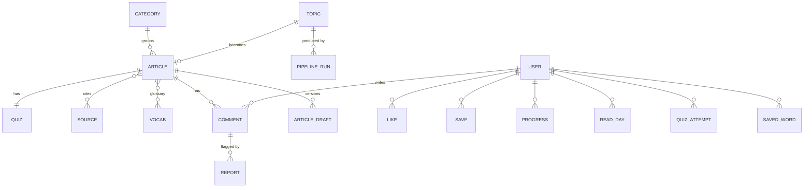

# 06 — Database

> Bản đầy đủ của data model, thay cho phần tóm tắt ở [02-technical-specs.md §3](./02-technical-specs.md#3-data-model-firestore). Bổ sung so với bản cũ: nguồn bài, pipeline, bài luyện tập IELTS, từ vựng, báo lỗi, phân quyền biên tập viên; bỏ dữ liệu "founding" (paywall).

## 1. Các kho dữ liệu

| Kho | Dùng cho | Lý do |
|-----|----------|-------|
| **Cloud Firestore** | Toàn bộ dữ liệu app: bài, câu hỏi, người dùng, tương tác, bình luận, pipeline | Realtime cho bình luận, đọc offline, Security Rules, đi cùng Firebase Auth |
| **Cloud Storage** | Snapshot văn bản nguồn, ảnh/video cover đã tối ưu, file export | File lớn không nên nằm trong Firestore |
| **Typesense** (Firebase extension "Search Firestore with Typesense") | Tìm kiếm toàn văn, không dấu, sửa lỗi gõ, lọc theo chủ đề/trình độ | Firestore không có full-text search; `array-contains-any` trên keywords chỉ đủ cho giai đoạn đầu |
| **BigQuery** | Analytics (export từ Firebase Analytics) và export Firestore định kỳ | Phân tích retention, tỷ lệ đọc hết, độ khó câu hỏi |
| **Secret Manager** | `ANTHROPIC_API_KEY`, key Unsplash/Pexels, key Typesense admin | Không để secret trong code hay biến môi trường công khai |

Chọn Firestore thay vì Postgres vì app đã chốt Firebase (Auth, realtime, offline). Các truy vấn cần JOIN (thống kê, báo cáo) chạy trên BigQuery, không chạy trên Firestore.

## 2. Sơ đồ quan hệ



## 3. Collections

Quy ước: `Timestamp` là Firestore Timestamp; `Lang = 'en' | 'vi'`; `Localized<T> = { en: T; vi?: T }`. Mọi interface đặt trong `lib/schema.ts` và có Zod schema tương ứng, dùng chung cho app, Cloud Functions và pipeline.

### 3.1 Rich text (cập nhật)

```ts
export type InlineNode =
  | { t: 'text'; v: string }
  | { t: 'bold'; v: string }
  | { t: 'italic'; v: string }
  | { t: 'hl'; v: string; color: 'yellow' | 'pink' | 'green' }
  | { t: 'cite'; v: string; sourceId: string }              // chip nguồn "CNBC (2025)"
  | { t: 'vocab'; v: string; lemma: string };               // MỚI: từ trong glossary, gạch chân chấm
export type RichParagraph = InlineNode[];
```

Pipeline sinh ra **markup** ngắn gọn (`**bold**`, `*italic*`, `[p:…]`, `{cite}`, `[[vocab:lemma|text]]`), giống prototype. Trước khi lưu, Cloud Function parse markup sang `InlineNode[]` và validate, để client không phải parse markup.

### 3.2 `articles/{articleId}`, bài đã xuất bản (read model cho feed)

```ts
interface Article {
  id: string;                        // = slug, ví dụ 'smarter-decisions'
  slug: string;
  status: 'scheduled' | 'published' | 'unpublished';
  publishAt: Timestamp;              // feed chỉ hiện bài có publishAt <= now
  categoryId: string;                // 'psychology'
  ieltsTopic: string;                // 'Psychology & Behaviour'
  level: 'B2' | 'C1' | 'C2';
  tags: string[];
  keywords: string[];                // chuẩn hoá không dấu, lowercase (fallback khi chưa có Typesense)
  cover: {
    type: 'image' | 'video';
    url: string; poster?: string; blurDataURL: string; dominant: string;
    provider: 'unsplash' | 'pexels' | 'wikimedia' | 'nasa' | 'own';
    author?: string; authorUrl?: string; license: string; sourceUrl?: string;
  };
  title: Localized<string>;
  standfirst: Localized<RichParagraph>;
  paragraphs: Array<{
    label: string;                   // 'A' … 'H'
    heading?: Localized<string>;
    body: Localized<RichParagraph>;
  }>;
  keyPoint: Localized<RichParagraph>;
  applySteps: Localized<string[]>;   // đúng 3
  glossary: string[];                // lemma → vocab/{lemma}
  sources: Array<{ id: string; label: string; publisher: string; year: number; url: string; license: string }>; // denormalize từ sources/
  hasQuiz: boolean;
  wordCount: number;                 // standfirst + body, bản EN
  readingMinutes: number;
  counts: { likes: number; saves: number; shares: number; comments: number; quizAttempts: number };
  rank: number;                      // điểm xếp feed, cập nhật mỗi giờ
  disclaimer?: 'health' | 'finance';
  version: number;                   // tăng mỗi lần xuất bản lại
  reviewedAt: Timestamp;
  reviewedBy: string;                // uid biên tập viên
  publishedAt: Timestamp;
  updatedAt: Timestamp;
}
```

Kích thước ước tính một bài: EN + VI khoảng 2.000 từ, cộng metadata, khoảng 30–40 KB, thấp hơn nhiều so với giới hạn 1 MB của mỗi document Firestore.

### 3.3 `quizzes/{articleId}`, bài luyện tập

```ts
interface Quiz {
  articleId: string;
  version: number;                   // khớp article.version
  timeLimitSec: number;              // mặc định 1200
  groups: Array<{
    type: 'tfng' | 'matching_headings' | 'sentence_completion' | 'multiple_choice';
    instructions: Localized<string>; // "Do the following statements agree with…"
    headings?: Array<{ id: string; text: string }>;           // cho matching_headings (i, ii, iii…)
    questions: Array<{
      id: string;                    // 'q1'
      prompt: string;                // câu hỏi (EN)
      paragraphLabel?: string;       // matching_headings: đoạn cần ghép
      options?: Array<{ id: string; text: string }>;          // multiple_choice
      answer: string;                // 'TRUE' | 'FALSE' | 'NOT GIVEN' | option id | heading id | chuỗi
      acceptedAnswers?: string[];    // sentence_completion: các cách viết được chấp nhận
      wordLimit?: number;            // 2
      explanation: Localized<string>;
      evidence?: { paragraphLabel: string; start: number; end: number }; // vị trí ký tự trong body EN
    }>;
  }>;
  stats: { attempts: number; avgScore: number; perQuestion: Record<string, { correct: number; total: number }> };
}
```

App miễn phí và đây là luyện tập, không phải thi thật, nên đáp án nằm ngay trong document và được chấm trên client. `stats` do Cloud Function cập nhật khi có `quizAttempts` mới, dùng để phát hiện câu quá dễ hoặc mơ hồ (tỷ lệ đúng < 20% hoặc > 95%).

### 3.4 `sources/{sourceId}`

```ts
interface Source {
  id: string;                        // hash của URL đã chuẩn hoá hoặc DOI
  url: string; doi?: string;
  title: string; publisher: string; authors?: string[]; year: number;
  provider: 'wikipedia' | 'openalex' | 'europepmc' | 'pubmed' | 'arxiv' | 'crossref' | 'owid' | 'gov' | 'gutenberg' | 'web';
  license: 'CC0' | 'CC-BY' | 'CC-BY-SA' | 'CC-BY-ND' | 'CC-BY-NC-SA' | 'PD' | 'copyrighted-facts-only' | 'unknown';
  usage: 'full-text' | 'abstract' | 'facts-only';
  isPreprint?: boolean;
  snapshotPath?: string;             // gs://…/sources/{id}.txt (chỉ admin đọc được)
  retrievedAt: Timestamp;
  usedBy: string[];                  // articleIds
}
```

### 3.5 `topics/{topicId}`, backlog chủ đề

```ts
interface Topic {
  title: string; angle?: string;     // góc tiếp cận
  categoryId: string; ieltsTopic: string; targetLevel: 'B2' | 'C1' | 'C2';
  origin: 'editor' | 'wikipedia-trending' | 'openalex';
  priority: 1 | 2 | 3;
  status: 'backlog' | 'in_pipeline' | 'in_review' | 'published' | 'rejected';
  possibleDuplicateOf?: string;      // articleId
  articleId?: string;
  createdBy: string; createdAt: Timestamp;
}
```

### 3.6 `articleDrafts/{draftId}` và `pipelineRuns/{runId}` (chỉ admin)

```ts
interface ArticleDraft {
  topicId: string; articleId?: string;     // có khi sửa bài đã xuất bản
  round: number;                            // vòng sửa
  content: Omit<Article, 'counts' | 'rank' | 'status' | 'publishAt' | 'reviewedAt' | 'reviewedBy' | 'publishedAt' | 'updatedAt' | 'version'>;
  quiz: Omit<Quiz, 'stats' | 'version'>;
  facts: Array<{ id: string; statement: string; sourceId: string; citedText: string; isNumber: boolean; confidence: 'high' | 'medium' | 'low' }>;
  sentenceFacts: Record<string, string[]>; // "A:2" (đoạn A, câu 2) → factIds
  checks: {
    unsupportedClaims: Array<{ where: string; text: string; severity: 'high' | 'medium' | 'low' }>;
    overlap: Array<{ where: string; ngram: string; sourceId: string }>;
    lengthOk: boolean; levelComputed: string; blindAnswerMismatches: string[]; translationIssues: string[];
  };
  review: { status: 'pending' | 'approved' | 'changes_requested' | 'rejected'; notes?: string; by?: string; at?: Timestamp };
  createdAt: Timestamp;
}

interface PipelineRun {
  topicId: string; draftId?: string;
  step: 'research' | 'facts' | 'draft' | 'verify' | 'translate' | 'practice' | 'blind' | 'done';
  status: 'queued' | 'running' | 'waiting_batch' | 'failed' | 'needs_human' | 'done';
  batchId?: string;                         // Message Batches id
  attempts: Record<string, number>;
  usage: Array<{ step: string; model: string; inputTokens: number; outputTokens: number; cacheReadTokens: number; batch: boolean; costUsd: number }>;
  error?: { step: string; message: string };
  createdAt: Timestamp; updatedAt: Timestamp; expireAt: Timestamp; // TTL 180 ngày
}
```

### 3.7 `categories/{id}`, `vocab/{lemma}`, `config/app`

```ts
interface Category { name: Localized<string>; emoji: string; order: number; ieltsTopics: string[]; articleCount: number }

interface Vocab {
  lemma: string;                     // 'phenomenon'
  pos: string; ipa: string;
  definition: string;                // EN, đơn giản
  translation: string;               // VI
  awlSublist?: number;               // 1–10
  cefr?: 'B1' | 'B2' | 'C1' | 'C2';
  examples: Array<{ articleId: string; sentence: string }>;
}

interface AppConfig {               // config/app
  minClientVersion: string;
  feedPageSize: number;              // 10
  featuredCategoryIds: string[];
}
```

### 3.8 `users/{uid}` và các subcollection

```ts
interface UserDoc {
  displayName: string; photoURL: string | null; email: string | null;
  isAnonymous: boolean;              // khách (xem 07)
  lang: Lang;
  timezone: string;
  targetBand?: number;               // 6.5, 7.0 … (onboarding, tùy chọn)
  interests: string[];               // categoryIds
  streak: { current: number; longest: number; lastReadDate: string | null };
  stats: { articlesRead: number; quizAttempts: number; wordsSaved: number };
  createdAt: Timestamp; lastActiveAt: Timestamp;
}
```

| Subcollection | Document ID | Fields | Ai ghi |
|---------------|-------------|--------|--------|
| `likes` | articleId | `createdAt` | client (chủ) |
| `saves` | articleId | `createdAt` | client (chủ) |
| `progress` | articleId | `lastParagraph, completed, completedAt, applyDone: boolean[3]` | client: `lastParagraph`, `applyDone`; Function: `completed*` |
| `readDays` | `YYYY-MM-DD` | `articles: string[]` | Function |
| `quizAttempts` | auto | `articleId, quizVersion, answers: Record<qid,string>, correct: string[], score, total, durationSec, createdAt` | client tạo, không sửa |
| `words` | lemma | `articleId, createdAt, reviewAt?, ease?` | client (chủ) |
| `notifications` | auto | `type, payload, read, createdAt` | Function (v1.1) |

### 3.9 Bình luận và báo lỗi

```ts
// articles/{articleId}/comments/{commentId}
interface Comment {
  uid: string; displayName: string; photoURL: string | null;   // denormalize lúc tạo
  text: string;                      // 1–500 ký tự
  lang: Lang;
  likeCount: number;
  status: 'visible' | 'hidden';      // hidden khi bị kiểm duyệt
  createdAt: Timestamp;
}

// reports/{reportId}: báo bình luận hoặc báo lỗi nội dung
interface Report {
  kind: 'comment' | 'content_error';
  articleId: string; commentId?: string;
  reason: 'spam' | 'abuse' | 'wrong_fact' | 'typo' | 'translation' | 'other';
  note?: string;
  uid: string; createdAt: Timestamp;
  status: 'open' | 'resolved' | 'dismissed'; resolvedBy?: string;
}
```

Bình luận không cần đăng nhập để **xem** (miễn phí, không giới hạn). Cần đăng nhập Google để **viết**, chống spam.

## 4. Truy vấn chính và index

| Màn hình | Truy vấn | Composite index |
|----------|----------|-----------------|
| Feed | `articles where status=='published' && publishAt<=now orderBy rank desc limit 10` | `status ASC, rank DESC` |
| Feed theo chủ đề | `… && categoryId==x orderBy rank desc` | `status, categoryId, rank DESC` |
| Explore theo trình độ | `… && level==x orderBy publishedAt desc` | `status, level, publishedAt DESC` |
| Search (trước khi có Typesense) | `… && keywords array-contains-any [tokens]` | `status, keywords (array), rank DESC` |
| Bình luận | `comments where status=='visible' orderBy createdAt desc limit 20` | `status, createdAt DESC` |
| Saved / Liked | `users/{uid}/saves orderBy createdAt desc` → batch get `articles` | mặc định |
| Lịch sử luyện tập | `users/{uid}/quizAttempts orderBy createdAt desc` | mặc định |
| Hàng đợi duyệt | `articleDrafts where review.status=='pending' orderBy createdAt` | `review.status, createdAt` |
| Báo cáo mở | `reports where status=='open' orderBy createdAt` | `status, createdAt` |

Lọc `publishAt <= now` cùng `orderBy rank` cần thêm bất đẳng thức trên một field khác field sắp xếp. Để tránh, Function **publisher** (chạy mỗi 5 phút) chuyển `scheduled → published` khi tới giờ, nên feed chỉ cần lọc `status == 'published'`.

## 5. Bộ đếm

- `counts.*` dùng `FieldValue.increment` trong transaction cùng document like/save (xem 02 §4.2).
- Firestore khuyến nghị khoảng 1 lần ghi/giây cho mỗi document. Khi một bài vượt ngưỡng này (theo dõi bằng log), chuyển sang **distributed counter** (extension "Distributed Counter", 10 shard) cho bài đó.
- `counts.comments`, `counts.quizAttempts`, `quizzes.stats` do Cloud Function cập nhật từ trigger.

## 6. Security Rules (bổ sung vào bản ở 02 §6)

```
function isStaff() { return request.auth != null && request.auth.token.role in ['editor', 'admin']; }
function isGoogleUser() { return request.auth != null && request.auth.token.firebase.sign_in_provider == 'google.com'; }

match /articles/{id} {
  allow read: if resource.data.status == 'published' || isStaff();
  // counters như bản cũ; còn lại chỉ Function/Admin SDK ghi
  match /comments/{cid} {
    allow read: if resource.data.status == 'visible' || isStaff();
    allow create: if isGoogleUser()
      && request.resource.data.uid == request.auth.uid
      && request.resource.data.status == 'visible'
      && request.resource.data.text is string
      && request.resource.data.text.size() >= 1 && request.resource.data.text.size() <= 500
      && request.resource.data.createdAt == request.time;
    allow update: if isStaff();                                  // ẩn/hiện
    allow delete: if request.auth.uid == resource.data.uid || isStaff();
  }
}
match /quizzes/{id}       { allow read: if true; }
match /categories/{id}    { allow read: if true; }
match /vocab/{id}         { allow read: if true; }
match /config/{id}        { allow read: if true; }
match /sources/{id}       { allow read: if isStaff(); }          // bài viết đã denormalize nguồn cần hiển thị
match /topics/{id}        { allow read, write: if isStaff(); }
match /articleDrafts/{id} { allow read, write: if isStaff(); }
match /pipelineRuns/{id}  { allow read: if isStaff(); }          // chỉ Function ghi
match /reports/{id} {
  allow create: if request.auth != null && request.resource.data.uid == request.auth.uid
                && request.resource.data.status == 'open';
  allow read, update: if isStaff();
}
match /users/{uid}/quizAttempts/{a} {
  allow read: if request.auth.uid == uid;
  allow create: if request.auth.uid == uid
    && request.resource.data.score is int && request.resource.data.score <= request.resource.data.total
    && request.resource.data.createdAt == request.time;
}
match /users/{uid}/words/{w} { allow read, write: if request.auth.uid == uid; }
```

Cloud Storage: `sources/**` chỉ `isStaff()` đọc; `covers/**` đọc công khai, chỉ Function ghi.

Rules được test bằng `@firebase/rules-unit-testing` trên emulator. Các ca bắt buộc: khách ẩn danh không viết được bình luận; người dùng không đọc được `articleDrafts`; không sửa được `quizAttempts`; không tự tăng `likes` lên 2.

## 7. Vòng đời dữ liệu và vận hành

| Mục | Chính sách |
|-----|-----------|
| Sao lưu | Export Firestore hằng ngày ra Cloud Storage (managed export), giữ 30 ngày |
| TTL | `pipelineRuns` 180 ngày (`expireAt`); snapshot nguồn giữ khi còn bài dùng tới |
| Xoá tài khoản | Callable `deleteAccount` xoá `users/{uid}` và toàn bộ subcollection; bình luận đổi thành tác giả "Deleted user" (giữ ngữ cảnh thảo luận) hoặc xoá theo lựa chọn của người dùng; xoá Auth user (xem 07) |
| Tài khoản khách bỏ dở | Function hằng tuần xoá user ẩn danh không hoạt động sau 60 ngày |
| Môi trường | 3 Firebase project: `reader-dev` (emulator + seed), `reader-staging`, `reader-prod` |
| Seed | `scripts/seed.ts` đọc `content/seed/*.json`, validate bằng Zod, ghi bằng Admin SDK |
| Migration | Mỗi thay đổi schema có script `scripts/migrations/NNN-*.ts`, chạy idempotent; field `schemaVersion` trong `config/app` |

## 8. Typesense (search)

- Collection `articles`: `id, title_en, title_vi, standfirst_en, body_en (plain), keywords, categoryId, level, rank, publishedAt`.
- Đồng bộ bằng extension Firestore → Typesense (chỉ document `status == 'published'`).
- Client tìm bằng **search-only API key có scoped filter** `status:published`, tạo từ Function và lưu trong `config/app`. Key admin chỉ nằm trong Secret Manager.
- Tiếng Việt: bật `locale: 'vi'`; ngoài ra lưu trường đã bỏ dấu để tìm "thien kien" ra "thiên kiến".
