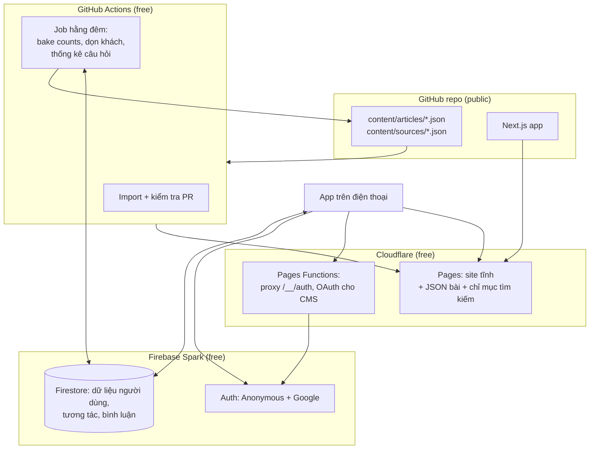

# 06 — Kiến trúc dữ liệu và hosting (100% miễn phí)

> Thay cho data model ở [02-technical-specs.md §3](./02-technical-specs.md#3-data-model-firestore) và các phần dùng Cloud Functions trong 02. Ràng buộc: **không gói trả phí, không cần thẻ thanh toán.** Mọi con số giới hạn free tier dưới đây cần kiểm tra lại trên trang giá chính thức trước khi triển khai, vì các nhà cung cấp hay thay đổi.

## 1. Tổng quan



| Thành phần | Dịch vụ | Free tier (kiểm tra lại) | Vai trò |
|-----------|---------|--------------------------|---------|
| Site + nội dung | **Cloudflare Pages** | Băng thông và request tĩnh không giới hạn; 500 build/tháng; tối đa 20.000 file mỗi site | Next.js `output: 'export'` (site tĩnh), file JSON bài, chỉ mục tìm kiếm, file từ vựng |
| Hàm nhỏ | **Cloudflare Pages Functions** (Workers) | 100.000 request/ngày | Proxy `/__/auth/*` cho đăng nhập Google, OAuth GitHub cho CMS |
| Đăng nhập | **Firebase Authentication** (gói Spark, **không** nâng cấp lên Identity Platform) | Google và Anonymous miễn phí | 07 |
| Dữ liệu người dùng | **Cloud Firestore** (gói Spark) | Khoảng 50.000 lần đọc, 20.000 lần ghi, 20.000 lần xoá mỗi ngày; 1 GiB lưu trữ | Like, lưu, tiến độ, streak, luyện tập, từ đã lưu, bình luận |
| Tác vụ nền | **GitHub Actions** | Không giới hạn phút cho repo public | Import, kiểm tra PR, Gemini (tùy chọn), job hằng đêm bằng Firebase Admin SDK |
| Ảnh/video | Unsplash, Pexels, Wikimedia (hotlink) | Miễn phí, có ghi công | Không dùng Firebase Storage (cần gói Blaze) |
| Analytics | **Cloudflare Web Analytics** | Miễn phí, không cookie | Lượt xem trang; sự kiện trong app thì đếm qua Firestore counters |

**Không dùng**: Cloud Functions, Cloud Storage, Typesense, BigQuery, Secret Manager. Các dịch vụ này cần gói Blaze (có thẻ) hoặc tốn phí.

Lý do tách như vậy: **nội dung bài là dữ liệu tĩnh**, ai cũng đọc giống nhau, nên phục vụ từ CDN (miễn phí, không giới hạn) thay vì Firestore (giới hạn 50.000 lần đọc/ngày). Firestore chỉ giữ những thứ riêng của từng người hoặc thay đổi liên tục.

## 2. Nội dung tĩnh trong Git

### 2.1 Cấu trúc thư mục

```
content/
├─ backlog.yaml                 # việc cần làm (05 §4.2)
├─ categories.json
├─ sources/<sourceId>.json      # metadata nguồn + giấy phép + điều khoản lúc import
├─ raw/<id>.json                # văn bản đã import (để đối chiếu, kiểm tra ND)
├─ articles/<slug>.json         # bài đã adapt (EN + VI nếu có) + quiz
└─ vocab/                       # NAWL, NGSL, dữ liệu Wiktionary đã lọc
public/data/                    # do script build sinh ra, KHÔNG sửa tay
├─ feed.json                    # danh sách bài rút gọn, đã sắp xếp
├─ articles/<slug>.json         # bản dùng cho client
├─ counts.json                  # bộ đếm like/save/share/comment, bake hằng đêm
├─ search-index.json            # chỉ mục MiniSearch
└─ vocab/<lemma>.json
```

### 2.2 Schema bài (`content/articles/<slug>.json`)

Mọi schema định nghĩa bằng Zod trong `lib/schema.ts`, dùng chung cho app, script và CI.

```ts
type Lang = 'en' | 'vi';
type Localized<T> = { en: T; vi?: T };

type InlineNode =
  | { t: 'text'; v: string }
  | { t: 'bold'; v: string }
  | { t: 'italic'; v: string }
  | { t: 'hl'; v: string; color: 'yellow' | 'pink' | 'green' }
  | { t: 'cite'; v: string; sourceId: string }
  | { t: 'vocab'; v: string; lemma: string };          // từ có popover nghĩa
type RichParagraph = InlineNode[];

interface Article {
  slug: string;
  status: 'draft' | 'published';
  publishAt: string;                                    // ISO; build bỏ qua bài chưa tới ngày
  categoryId: string;
  ieltsTopic: string;
  level: 'B1' | 'B2' | 'C1' | 'C2';
  tags: string[];
  keywords: string[];                                   // cho tìm kiếm
  cover: { type: 'image' | 'video'; url: string; poster?: string; blurDataURL: string; dominant: string;
           provider: 'unsplash' | 'pexels' | 'wikimedia' | 'nasa' | 'source' | 'own';
           author?: string; authorUrl?: string; license: string; sourceUrl?: string };
  title: Localized<string>;
  standfirst: Localized<RichParagraph>;
  paragraphs: Array<{ label: string; heading?: Localized<string>; body: Localized<RichParagraph> }>;
  keyPoint?: Localized<RichParagraph>;
  applySteps?: Localized<string[]>;
  glossary: string[];                                   // lemma
  origin: {
    group: 1 | 2 | 3 | 4;                               // nhóm nguồn ở 05 §2
    sourceId: string;                                   // content/sources/<id>.json
    license: 'CC-BY-4.0' | 'CC-BY-3.0' | 'CC-BY-SA-4.0' | 'CC-BY-ND-4.0' | 'CC-BY-NC-ND' | 'PD' | 'Reader-CC-BY-4.0';
    authors: string[];
    originalTitle: string; originalUrl: string;
    changes: string[];                                  // ["shortened", "divided into lettered paragraphs"]
    permission?: string;                                // link bằng chứng tác giả đồng ý (nhóm 3, bản dịch)
  };
  references: Array<{ id: string; label: string; url: string }>;   // chip nguồn trong bài
  quiz?: Quiz;
  ai?: { model: string; fields: string[]; reviewedBy: string };    // nếu có gợi ý Gemini đã duyệt
  wordCount: number; readingMinutes: number;
  reviewedAt: string; reviewedBy: string;               // GitHub username
}

interface Quiz {
  timeLimitSec: number;
  groups: Array<{
    type: 'tfng' | 'matching_headings' | 'sentence_completion' | 'multiple_choice' | 'gap_fill' | 'matching_information';
    instructions: Localized<string>;
    headings?: Array<{ id: string; text: string }>;
    wordBank?: string[];
    questions: Array<{
      id: string; prompt: string; paragraphLabel?: string;
      options?: Array<{ id: string; text: string }>;
      answer: string; acceptedAnswers?: string[]; wordLimit?: number;
      explanation?: Localized<string>;
      evidence?: { paragraphLabel: string; start: number; end: number };
      generatedBy: 'rule' | 'editor' | 'community' | 'gemini';
    }>;
  }>;
}
```

### 2.3 Build

- `scripts/build-content.ts` chạy trước `next build`. Script này validate mọi file, bỏ bài `draft` hoặc chưa tới `publishAt`, rồi sinh `public/data/*`. Mỗi bài có trang tĩnh `/a/<slug>` (tốt cho SEO và chia sẻ).
- **Xếp feed** lúc build: bài mới cộng điểm, cộng điểm tương tác từ `counts.json`, đan xen các chủ đề.
- **Xuất bản theo lịch**: GitHub Action hằng ngày trigger build (Cloudflare Pages deploy hook), để bài có `publishAt` hôm nay lên site.
- **Tìm kiếm**: chỉ mục **MiniSearch** gồm title EN/VI, standfirst, keywords, heading. Dùng hàm chuẩn hoá bỏ dấu tiếng Việt, nên gõ "thien kien" ra "thiên kiến". Tìm hoàn toàn trên client, không cần server.

## 3. Firestore (gói Spark): chỉ dữ liệu động

### 3.1 Collections

```ts
// users/{uid}
interface UserDoc {
  displayName: string | null; photoURL: string | null;
  isAnonymous: boolean;
  lang: Lang; timezone: string;
  targetBand?: number; interests: string[];
  streak: { current: number; longest: number; lastReadDate: string | null };
  stats: { articlesRead: number; quizAttempts: number; wordsSaved: number };
  createdAt: Timestamp; lastActiveAt: Timestamp;
}
```

| Path | Document ID | Fields | Ghi chú |
|------|-------------|--------|---------|
| `users/{uid}/likes` | slug | `createdAt` | |
| `users/{uid}/saves` | slug | `createdAt` | |
| `users/{uid}/progress` | slug | `lastParagraph, completed, completedAt, applyDone[3]` | |
| `users/{uid}/readDays` | `YYYY-MM-DD` | `slugs: string[]` | Lịch streak |
| `users/{uid}/quizAttempts` | auto | `slug, answers, correct[], score, total, durationSec, createdAt` | Tạo xong không sửa |
| `users/{uid}/words` | lemma | `slug, createdAt, reviewAt?, ease?` | |
| `counters/{slug}` | slug | `likes, saves, shares, comments` | Bộ đếm sống |
| `comments/{slug}/items/{id}` | auto | `uid, displayName, photoURL, text, lang, status, createdAt` | |
| `reports/{id}` | auto | `kind, slug, commentId?, reason, note, uid, status, createdAt` | Báo bình luận hoặc báo lỗi nội dung |
| `questionSuggestions/{id}` | auto | `slug, type, prompt, answer, explanation, uid, status, createdAt` | 05 §5.2 |
| `submissions/{id}` | auto | `title, body, sources, uid, status, createdAt` | Bài cộng đồng gửi từ nút + |
| `moderators/{uid}` | uid | `role: 'moderator' \| 'admin'` | Danh sách ai được ẩn bình luận; chỉ Admin SDK ghi |

Bài và câu hỏi **không** nằm trong Firestore (chúng ở JSON tĩnh).

### 3.2 Logic chạy trên client thay cho Cloud Functions

| Việc | Cách làm | Rules bảo vệ |
|------|----------|--------------|
| Like/save | Transaction: tạo/xoá `users/{uid}/likes/{slug}` và `counters/{slug}.likes ± 1` | Chỉ ±1, và phải có/không có doc like tương ứng (`existsAfter`) |
| Share | `counters/{slug}.shares + 1` | Chỉ +1; cần đăng nhập (kể cả khách) |
| Bình luận | Batch: tạo comment + `counters/{slug}.comments + 1` | Cần tài khoản Google; độ dài 1–500; `existsAfter` cho comment |
| Streak | Client tính `nextStreak` (02 §4.4), batch ghi `users/{uid}.streak` + `readDays/{date}` | `current` chỉ được giữ nguyên, tăng 1, hoặc về 1; `readDays/{lastReadDate}` phải tồn tại sau batch. Gian lận streak trên app miễn phí không gây hại, nên kiểm tra ở mức này là đủ |
| Kết quả luyện tập | Chấm trên client, tạo `quizAttempts` | `score <= total`, không cho sửa |
| Gộp dữ liệu khách → Google | Client làm (07 §3.2) | Chỉ ghi vào uid của chính mình |
| Xoá tài khoản | Client xoá các subcollection của mình, rồi `user.delete()` (07 §7) | Chủ sở hữu được xoá |

### 3.3 Job hằng đêm (GitHub Actions + Firebase Admin SDK)

Service account JSON lưu trong **GitHub Actions secrets**. Các job:

1. **Bake counts**: đọc `counters/*` (mỗi bài 1 lần đọc), ghi `public/data/counts.json`, commit và trigger build. Feed hiển thị số đếm của đêm qua mà không tốn lượt đọc Firestore.
2. **Dọn khách**: xoá user ẩn danh không hoạt động sau 60 ngày (Admin Auth API + xoá dữ liệu).
3. **Thống kê câu hỏi**: collection-group query các `quizAttempts` tạo trong 24 giờ qua, cộng dồn tỷ lệ đúng từng câu vào `content/stats/quiz.json` để biên tập viên tìm câu quá dễ hoặc mơ hồ.
4. **Gán quyền moderator**: workflow chạy tay `set-moderator.yml` (nhập email) ghi `moderators/{uid}`.
5. **Sao lưu**: export các collection nhỏ ra JSON, upload thành artifact của workflow (giữ 30 ngày) hoặc commit vào một repo private.

### 3.4 Ngân sách lượt đọc/ghi (để ở lại gói miễn phí)

Ước tính cho một phiên điển hình (đọc 5 bài, mở bình luận 1 lần, làm 1 bài luyện tập):

| Thao tác | Đọc | Ghi |
|----------|----:|----:|
| Tải hồ sơ + streak lúc mở app | 1 | 0–1 |
| Trạng thái like/save của 5 bài (query theo slug trong `likes`, `saves`) | ~2–10 | 0 |
| Bộ đếm sống khi mở Details (5 bài) | 5 | 0 |
| Mở bình luận 1 bài (`get`, limit 20, không giữ listener) | ~20 | 0 |
| Like 2 bài, lưu 1 bài | 3 | 6 |
| Hoàn thành 1 bài (streak, readDays, progress) | 1 | 3 |
| Làm 1 bài luyện tập | 0 | 1 |
| **Tổng** | **~35–40** | **~10** |

50.000 lượt đọc/ngày ÷ ~40 ≈ **1.200–1.500 người dùng hoạt động/ngày** trước khi chạm trần đọc; trần ghi 20.000/ngày ÷ ~10 ≈ 2.000. Các cách giữ trong ngân sách:

- Feed và số đếm lấy từ JSON tĩnh; chỉ đọc bộ đếm sống khi người dùng mở Details.
- Bật **offline persistence** của Firestore (cache IndexedDB) để không đọc lại tài liệu đã có.
- Bình luận dùng `get()` có phân trang; chỉ bật `onSnapshot` khi tab bình luận đang mở.
- Khi gần trần quota (Firestore trả lỗi `resource-exhausted`), app vẫn đọc bài được bình thường; chỉ like/bình luận tạm báo "thử lại sau".

Nếu app vượt mức này, hướng đi (khi đó mới cần quyết định chi phí): chuyển bộ đếm sang Cloudflare Workers KV/D1 (free tier riêng), hoặc nâng Firebase lên Blaze.

### 3.5 Security Rules (chính)

```
rules_version = '2';
service cloud.firestore {
  match /databases/{db}/documents {
    function signedIn() { return request.auth != null; }
    function isMe(uid) { return signedIn() && request.auth.uid == uid; }
    function isGoogle() { return signedIn() && request.auth.token.firebase.sign_in_provider == 'google.com'; }
    function isMod() { return signedIn() && exists(/databases/$(db)/documents/moderators/$(request.auth.uid)); }
    function onlyDelta(field, d) {
      return request.resource.data.diff(resource.data).affectedKeys().hasOnly([field])
        && request.resource.data[field] == resource.data[field] + d;
    }

    match /users/{uid} {
      allow read, create, delete: if isMe(uid);
      allow update: if isMe(uid)
        && request.resource.data.diff(resource.data).affectedKeys()
             .hasOnly(['displayName', 'photoURL', 'isAnonymous', 'lang', 'timezone', 'targetBand', 'interests', 'streak', 'stats', 'lastActiveAt'])
        && (request.resource.data.streak.current == resource.data.streak.current
            || request.resource.data.streak.current == resource.data.streak.current + 1
            || request.resource.data.streak.current == 1);
      match /quizAttempts/{a} {
        allow read, delete: if isMe(uid);
        allow create: if isMe(uid) && request.resource.data.score <= request.resource.data.total;
      }
      match /{sub}/{doc} {
        allow read, write: if isMe(uid) && sub in ['likes', 'saves', 'progress', 'readDays', 'words'];
      }
    }

    match /counters/{slug} {
      allow read: if true;
      allow create: if signedIn() && request.resource.data.keys().hasOnly(['likes', 'saves', 'shares', 'comments']);
      allow update: if signedIn() && (
           (onlyDelta('likes', 1)  && existsAfter(/databases/$(db)/documents/users/$(request.auth.uid)/likes/$(slug)))
        || (onlyDelta('likes', -1) && !existsAfter(/databases/$(db)/documents/users/$(request.auth.uid)/likes/$(slug)))
        || (onlyDelta('saves', 1)  && existsAfter(/databases/$(db)/documents/users/$(request.auth.uid)/saves/$(slug)))
        || (onlyDelta('saves', -1) && !existsAfter(/databases/$(db)/documents/users/$(request.auth.uid)/saves/$(slug)))
        || onlyDelta('shares', 1)
        || (isGoogle() && onlyDelta('comments', 1)));
    }

    match /comments/{slug}/items/{id} {
      allow read: if resource.data.status == 'visible' || isMod();
      allow create: if isGoogle()
        && request.resource.data.uid == request.auth.uid
        && request.resource.data.status == 'visible'
        && request.resource.data.text is string
        && request.resource.data.text.size() >= 1 && request.resource.data.text.size() <= 500
        && request.resource.data.createdAt == request.time;
      allow update: if isMod() && request.resource.data.diff(resource.data).affectedKeys().hasOnly(['status']);
      allow delete: if (signedIn() && resource.data.uid == request.auth.uid) || isMod();
    }

    match /reports/{id} {
      allow create: if signedIn() && request.resource.data.uid == request.auth.uid && request.resource.data.status == 'open';
      allow read, update: if isMod();
    }
    match /questionSuggestions/{id} {
      allow create: if isGoogle() && request.resource.data.uid == request.auth.uid && request.resource.data.status == 'pending';
      allow read, update: if isMod();
    }
    match /submissions/{id} {
      allow create: if isGoogle() && request.resource.data.uid == request.auth.uid && request.resource.data.status == 'pending';
      allow read: if isMod() || (signedIn() && resource.data.uid == request.auth.uid);
      allow update: if isMod();
    }
    match /moderators/{uid} { allow read: if isMe(uid); }   // chỉ Admin SDK ghi
  }
}
```

Rules được test bằng `@firebase/rules-unit-testing` trên Firestore Emulator (miễn phí, chạy trong GitHub Actions).

### 3.6 Index

| Truy vấn | Index |
|----------|-------|
| `comments/{slug}/items where status=='visible' orderBy createdAt desc` | `status ASC, createdAt DESC` |
| `users/{uid}/quizAttempts orderBy createdAt desc` | mặc định |
| collection group `quizAttempts where createdAt > X` (job đêm) | collection-group index trên `createdAt` |
| `reports where status=='open' orderBy createdAt` | `status, createdAt` |

## 4. Môi trường

| Môi trường | Firebase | Cloudflare | Ghi chú |
|------------|----------|------------|---------|
| Local | Emulator Suite (Auth + Firestore) | `next dev` | Seed từ `content/` |
| Preview | project `reader-dev` (Spark) | Preview deployment theo từng PR | Miễn phí |
| Production | project `reader-prod` (Spark) | Production branch `main` | |

## 5. Quyền riêng tư và vòng đời dữ liệu

- Dữ liệu cá nhân chỉ nằm trong Firestore (`users/{uid}`, bình luận). Nội dung tĩnh không chứa dữ liệu người dùng.
- Xoá tài khoản: client xoá toàn bộ dữ liệu của mình; bình luận chuyển thành "Deleted user" hoặc bị xoá theo lựa chọn (07 §7).
- Khách không hoạt động 60 ngày bị dọn bởi job đêm.
- Không gửi dữ liệu người dùng cho Gemini hay bên thứ ba nào.
