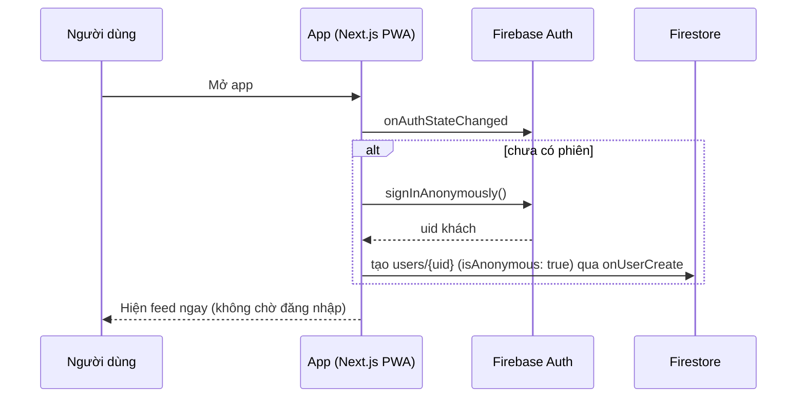

# 07 — Đăng nhập và tài khoản

> Thay cho FR-19 trong PRD. Mục tiêu: **đọc ngay không cần đăng nhập**, nhưng mọi tiến độ (like, lưu, streak, luyện tập) đều được giữ lại và gộp vào tài khoản khi người dùng đăng nhập bằng Google.

## 1. Phương thức

| Phương thức | Giai đoạn | Ghi chú |
|-------------|-----------|---------|
| **Khách (Firebase Anonymous Auth)** | MVP | Tự động, không có màn hình. Có `uid` thật nên dữ liệu lưu được trên server |
| **Google** | MVP, **bắt buộc** | Firebase Auth `GoogleAuthProvider`, scope `openid email profile` |
| Google One Tap | MVP (Android/Chrome desktop) | Google Identity Services, rồi `signInWithCredential` |
| Email link (passwordless) | v1.1 | Cho người không dùng Google |
| Sign in with Apple | Khi có app iOS native | App Store yêu cầu khi app native có đăng nhập Google |

Không dùng mật khẩu (giảm rủi ro bảo mật và thao tác "quên mật khẩu").

## 2. Quyền theo trạng thái

| Hành động | Khách | Google |
|-----------|:-----:|:------:|
| Đọc bài, xem bình luận, làm bài luyện tập, đổi ngôn ngữ | ✅ | ✅ |
| Like, lưu bài, streak, lưu từ, lịch sử luyện tập | ✅ (lưu theo uid khách, chỉ trên thiết bị này) | ✅ (đồng bộ mọi thiết bị) |
| Viết bình luận, báo lỗi | ❌ (mở LoginSheet) | ✅ |
| Hồ sơ công khai (tên, ảnh) | ❌ | ✅ |
| /admin | ❌ | Chỉ khi có custom claim `role` |

App miễn phí, nên đăng nhập chỉ để đồng bộ dữ liệu và chống spam bình luận, không mở khoá nội dung nào.

## 3. Luồng

### 3.1 Lần đầu mở app



Feed không chờ Auth: trang đầu được render sẵn trên server (SSR), Auth khởi động song song.

### 3.2 Nâng cấp khách thành tài khoản Google (giữ nguyên uid)

1. Người dùng chạm "Continue with Google" (LoginSheet, avatar ở header, hoặc khi thử viết bình luận).
2. App gọi `linkWithPopup(currentUser, googleProvider)` hoặc `linkWithRedirect` (bảng 3.3).
3. **Thành công:** uid giữ nguyên, toàn bộ like, streak, luyện tập vẫn còn. Function `onUserLinked` (callable gọi sau khi link) cập nhật `users/{uid}`: `isAnonymous: false`, `displayName`, `photoURL`, `email`.
4. **Lỗi `auth/credential-already-in-use`** (tài khoản Google này đã dùng Reader ở thiết bị khác):
   - Lấy credential từ lỗi (`GoogleAuthProvider.credentialFromError`) rồi `signInWithCredential`.
   - Gọi callable `mergeGuest({ guestUid })`. Server kiểm tra caller là chủ tài khoản đích và uid khách còn tồn tại, rồi gộp: likes/saves/words lấy hợp; progress lấy bản tiến xa hơn; streak lấy bản có `lastReadDate` mới hơn, nếu cùng ngày thì lấy `current` lớn hơn; quizAttempts chuyển sang. Sau đó xoá user khách.
   - Để chứng minh quyền sở hữu uid khách, client gửi kèm **ID token của phiên khách** lấy ngay trước khi đăng nhập Google; server `verifyIdToken` token này.
5. Toast: "Signed in as {name}. Your progress is saved."

### 3.3 Chọn popup hay redirect theo môi trường

| Môi trường | Cách đăng nhập | Lý do |
|------------|---------------|-------|
| Desktop browser | `signInWithPopup` / `linkWithPopup` | Nhanh, không rời trang |
| Chrome Android / Chrome desktop | Google One Tap (GIS, có FedCM), rồi `signInWithCredential(GoogleAuthProvider.credential(idToken))`; fallback bằng popup | Một chạm, không mở cửa sổ |
| Safari iOS, **PWA standalone** (đã thêm vào màn hình chính) | `signInWithRedirect` / `linkWithRedirect` + `getRedirectResult` khi load lại | Popup trong chế độ standalone hay bị chặn hoặc không trả kết quả về app |
| In-app browser (Facebook, Zalo, TikTok…) | Hiện hướng dẫn "Mở trong Safari/Chrome" + nút copy link | Google chặn OAuth trong webview nhúng (`disallowed_useragent`) |

Phát hiện bằng `matchMedia('(display-mode: standalone)')`, `navigator.standalone` và user agent của in-app browser. Đây là ngoại lệ hợp lệ cho việc dò user agent, vì không có API tính năng nào thay thế được.

### 3.4 Bắt buộc cho redirect: authDomain cùng domain với app

Safari và Chrome chặn lưu trữ bên thứ ba, nên `signInWithRedirect` chỉ hoạt động ổn định khi `authDomain` trùng domain của app. Chọn một trong hai cách:

- **A. Deploy trên Firebase Hosting (App Hosting) với custom domain**, ví dụ `reader.app`, và đặt `authDomain: 'reader.app'`. Handler `/__/auth/*` có sẵn.
- **B. Deploy trên Vercel/khác**: thêm rewrite trong `next.config.ts`:
  ```ts
  async rewrites() {
    return [{ source: '/__/auth/:path*', destination: 'https://<project-id>.firebaseapp.com/__/auth/:path*' }];
  }
  ```
  Rồi đặt `authDomain` = domain của app.

Với cả hai cách: thêm `https://reader.app/__/auth/handler` vào **Authorized redirect URIs** của OAuth client trong Google Cloud Console, và thêm domain vào **Authorized domains** trong Firebase Auth.

## 4. Cấu hình Google Cloud / Firebase (checklist)

1. Firebase Console → Authentication → Sign-in method: bật **Google** và **Anonymous**.
2. Google Cloud → OAuth consent screen:
   - User type **External**; tên app "Reader"; email hỗ trợ; logo 120×120.
   - Link **Privacy Policy** và **Terms** (trang `/privacy`, `/terms` trong app).
   - Authorized domains: domain của app.
   - Scopes: chỉ `openid`, `email`, `profile` (không nhạy cảm, không cần security assessment).
   - Chuyển trạng thái **In production**; nộp **brand verification** để logo và tên hiện trên màn hình chọn tài khoản.
3. OAuth client (Web): JavaScript origins = domain prod + `http://localhost:3000`; redirect URIs như 3.4.
4. Client ID Web dùng cho Google One Tap (`NEXT_PUBLIC_GOOGLE_CLIENT_ID`).
5. Bật **App Check** (reCAPTCHA Enterprise) cho Firestore, Functions, Storage.
6. Ba project dev/staging/prod có OAuth client riêng.

## 5. Phiên đăng nhập phía server

- Client giữ phiên bằng Firebase Auth SDK (IndexedDB persistence).
- Cần dữ liệu cá nhân khi SSR (ví dụ đánh dấu bài đã lưu ngay trong HTML đầu) hoặc bảo vệ `/admin`:
  - Route `POST /api/session` nhận ID token, gọi Admin SDK `createSessionCookie` (14 ngày), set cookie `__session` (`HttpOnly`, `Secure`, `SameSite=Lax`).
  - `middleware.ts` chặn `/admin/**`: verify session cookie (`checkRevoked: true`) và `role` trong claims.
  - `POST /api/session/logout` xoá cookie và `revokeRefreshTokens` khi cần.
  - Chống CSRF: chỉ nhận `POST` có header `X-Requested-With` và kiểm tra `Origin`.
- MVP có thể bỏ SSR cá nhân hoá (feed SSR công khai, cá nhân hoá trên client), nhưng `/admin` **phải** có kiểm tra phía server.

## 6. Phân quyền biên tập

- Custom claim `role: 'editor' | 'admin'`, gán bằng script `scripts/set-role.ts <email> <role>` (Admin SDK) hoặc trang quản lý trong /admin (chỉ `admin`).
- Rules dùng `request.auth.token.role` (xem 06 §6). Sau khi gán role, client gọi `getIdToken(true)` để nhận claim mới.

## 7. Hồ sơ và xoá tài khoản

- **Profile** (SCR-07): avatar và tên từ Google (sửa được tên hiển thị), ngôn ngữ, band mục tiêu, chủ đề quan tâm, thống kê streak/bài đã đọc/luyện tập.
- **Đăng xuất**: `signOut()`. Sau đó app tự `signInAnonymously()` lại để tiếp tục đọc; dữ liệu cũ vẫn nằm trong tài khoản Google.
- **Xoá tài khoản** (Profile → Settings → Delete account), có màn xác nhận ngay trong app (không dùng `confirm()`):
  - Callable `deleteAccount`: xoá `users/{uid}` và subcollection, xử lý bình luận theo lựa chọn (ẩn danh hoá hoặc xoá), rồi `admin.auth().deleteUser(uid)`.
  - Nếu Firebase yêu cầu đăng nhập lại gần đây (`auth/requires-recent-login`), app `reauthenticateWithPopup/Redirect` rồi gọi lại.
- **Xuất dữ liệu** (v1.1): callable tạo file JSON gồm hồ sơ, likes, saves, lịch sử luyện tập, bình luận.

## 8. Quyền riêng tư

- Chỉ thu thập: tên, email, ảnh đại diện từ Google, cùng dữ liệu sử dụng trong app.
- Trang `/privacy` nêu mục đích, thời gian lưu, quyền xoá và quyền xuất dữ liệu, theo **Nghị định 13/2023/NĐ-CP** về bảo vệ dữ liệu cá nhân và chính sách Google API User Data.
- Lần đăng nhập đầu tiên hiện một dòng đồng ý kèm link Privacy/Terms ngay dưới nút "Continue with Google".
- Analytics không gửi email hay tên; chỉ dùng uid đã băm.

## 9. UI (cập nhật CMP-23 LoginSheet)

- Tiêu đề: "Save your progress" / "Lưu tiến độ của bạn".
- Mô tả: "Sign in to sync your streak, saved articles and practice history across devices." App miễn phí nên không nói gì về mở khoá nội dung.
- Nút chính: "Continue with Google" (nền trắng, logo G đúng chuẩn thương hiệu Google). Nút phụ: "Not now".
- Trạng thái và lỗi:

| Mã / tình huống | Thông báo |
|-----------------|-----------|
| `auth/popup-closed-by-user`, `auth/cancelled-popup-request` | Không báo gì, đóng spinner |
| `auth/popup-blocked` | Tự chuyển sang redirect |
| `auth/network-request-failed` | "No connection. Check your internet and try again." |
| `auth/credential-already-in-use` | Chạy luồng gộp 3.2 bước 4, hiện "Merging your progress…" |
| In-app browser | "Google sign-in doesn't work inside this app. Open Reader in Safari or Chrome." + nút copy link |
| Lỗi khác | "Couldn't sign in. Try again." + mã lỗi nhỏ để hỗ trợ |

## 10. Kiểm thử

- Firebase **Auth Emulator** cho dev và E2E (Playwright đăng nhập bằng tài khoản giả của emulator).
- Ca bắt buộc:
  1. Khách like 2 bài, đọc xong 1 bài (streak 1), rồi đăng nhập Google: uid giữ nguyên, dữ liệu còn đủ.
  2. Thiết bị B đã có tài khoản Google (streak 5). Khách ở thiết bị A có streak 1, đăng nhập cùng tài khoản: dữ liệu gộp đúng, streak 5, user khách bị xoá.
  3. Khách không viết được bình luận (Rules từ chối).
  4. Truy cập `/admin` không có role thì nhận 403 từ middleware.
  5. Xoá tài khoản thì không còn document nào dưới `users/{uid}`.
- Kiểm tra thủ công trên **máy thật**: iPhone (Safari và PWA standalone), Android Chrome (One Tap), in-app browser Zalo/Facebook.

## 11. Cloud Functions liên quan

| Function | Loại | Việc |
|----------|------|------|
| `onUserCreate` | Auth trigger | Tạo `users/{uid}` mặc định (`isAnonymous` theo provider) |
| `onUserLinked` | Callable | Cập nhật hồ sơ sau khi khách link Google |
| `mergeGuest` | Callable | Gộp dữ liệu khách vào tài khoản có sẵn (3.2) |
| `deleteAccount` | Callable | Xoá tài khoản và dữ liệu (7) |
| `cleanupGuests` | Scheduled hằng tuần | Xoá khách không hoạt động sau 60 ngày |
| `setRole` | Callable (chỉ `admin`) | Gán custom claim |
